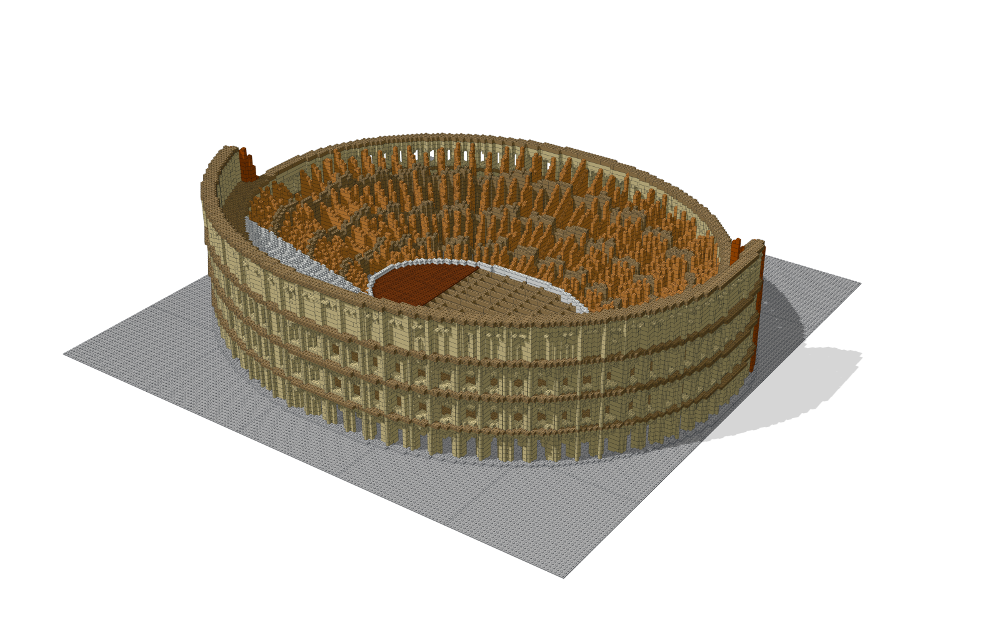

# bricky

A compiler-style toolkit that lets AI agents design buildable LEGO® models.

[](https://maxencefaldor.github.io/bricky/gallery/)

An AI agent writes a LEGO® model as a Python build script, and bricky builds it the way a compiler builds code.
Each build places every part in exact geometry, reports each mistake with the script line behind it, and renders four views with rulers.

The [documentation](https://maxencefaldor.github.io/bricky/) explains every concept and lists every command.

## 🚀 Quick start

The quick start needs [uv](https://docs.astral.sh/uv/), which installs Python 3.12 or newer if needed.
A uv project holds your build scripts, and `uv add` installs bricky into it from PyPI:

```sh
uv init --bare my-models && cd my-models  # a project for your build scripts
uv add bricky                             # bricky and every dependency, from PyPI
uv run playwright install chromium        # the browser bricky renders in, once per machine
```

Download an example and build it, which checks the model and renders it beside the script:

```sh
curl -O https://raw.githubusercontent.com/maxencefaldor/bricky/main/examples/japanese_garden.py
uv run bricky build japanese_garden.py
```

With pip, run `pip install bricky` and then `playwright install chromium`.
On Linux, `playwright install --with-deps chromium` also installs the browser's system libraries.
To install bricky as a tool, run `uv tool install bricky --with-executables-from playwright`, then `playwright install chromium`.
The command is then `bricky`, without `uv run`.
A clone of the repository runs every example and the benchmark: [Get started](https://maxencefaldor.github.io/bricky/get-started/#install) shows how.

## 🤖 Use it with an agent

An agent reaches bricky through one of three front ends:

- **The command line**, for any harness that runs shell commands: the agent runs `uv run bricky build` and reads the report and the images.
- **The MCP server**, for any harness that speaks the Model Context Protocol: `claude mcp add bricky -- uvx bricky-mcp` adds it to Claude Code.
- **The skill**, which teaches the agent the build loop: [Connect an agent](https://maxencefaldor.github.io/bricky/agents/connect/#skill) shows how to install it.

## 🧱 How it works

A build script places parts by their BrickLink id, in studs and plates.
The four lines below come from [`examples/broken.py`](https://github.com/maxencefaldor/bricky/blob/main/examples/broken.py), which makes three mistakes: an overlap, a brick half a stud off and a floating plate.

```python
builder.place("3001", at=(0, 0, 0), color="Red", id="base")  # Brick 2 x 4
builder.place("3001", at=(1, 0, 0), color="Blue", id="overlap")  # shares space
builder.place("3003", at=(0.5, 0, 3), color="White", id="offset")  # half a stud off
builder.place("3022", at=(4, 2, 9), color="Tan", id="floating")  # touches nothing
```

The report reads like compiler output, and every element it names points back at the script:

```text
error[E201]: base and overlap occupy the same space
  --> x 1..2  y 0..4  z 0..3
   = base: Brick 2 x 4 (3001), Red, examples/broken.py:15 in build()
   = overlap: Brick 2 x 4 (3001), Blue, examples/broken.py:16 in build()
```

The image marks the same elements in red, so the agent sees where they are:


## ⚖️ Disclaimer

LEGO® is a trademark of the LEGO Group, which does not sponsor, authorize or endorse this project.
