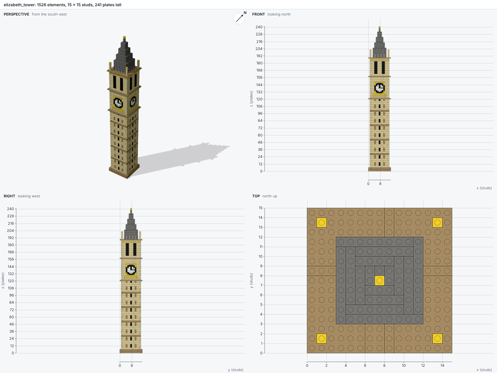

# bricky

[](https://github.com/maxencefaldor/bricky/actions/workflows/ci.yml)
[](https://maxencefaldor.github.io/bricky/)
[](LICENSE)

A compiler-style toolkit that lets AI agents design buildable LEGO® models.

An agent writes a model as a Python build script. bricky runs the script, places every part in
exact geometry, checks that the model holds together, and draws it. Every answer states facts the
agent can act on: each diagnostic names the script line behind its parts, and every picture
carries rulers in studs and plates. bricky never fixes a model; deciding what to change stays the
agent's job.



**[Documentation](https://maxencefaldor.github.io/bricky/)** ·
[Get started](https://maxencefaldor.github.io/bricky/get-started/) ·
[Examples](https://maxencefaldor.github.io/bricky/examples/) ·
[MCP server](https://maxencefaldor.github.io/bricky/agents/mcp/) ·
[Benchmark](https://maxencefaldor.github.io/bricky/agents/benchmark/)

## Quick start

```sh
git clone https://github.com/maxencefaldor/bricky
cd bricky
uv sync
uv run playwright install chromium            # the browser renders draw in, once per machine
uv run bricky build examples/cottage.py       # 0 errors, and examples/cottage.png
uv run bricky build examples/broken.py        # one mistake of each kind
```

A build script places parts by BrickLink id, in studs and plates:

```python
from bricky import ModelBuilder


def build() -> ModelBuilder:
    builder = ModelBuilder("wall")
    builder.place("3001", at=(0, 0, 0), color="Red")  # Brick 2 x 4
    builder.place("3001", at=(0, 2, 3), rotation="R90", color="Red")  # rotated a quarter turn
    return builder
```

A broken model reads like compiler output, and every element it names points back at the script:

```text
error[E201]: base and overlap occupy the same space
  --> x 1..2  y 0..4  z 0..3
   = base: Brick 2 x 4 (3001), Red, examples/broken.py:12 in build()
   = overlap: Brick 2 x 4 (3001), Blue, examples/broken.py:13 in build()
```

The picture marks the same elements, so the agent sees where they are:


## What bricky does

- **Exact geometry.** Every length is a whole number of 0.4 mm units: positions, the 24 grid
  rotations and every overlap test are exact.
- **Real parts.** The catalog holds every part and color BrickLink lists. Bricks, plates, tiles,
  slopes, round parts, arches, jumpers and bricks with side studs get exact shapes from their
  names; the LDraw.org Parts Library shapes thousands more.
- **Checks that state facts.** Overlaps, blocked studs, floating groups, parts below the ground and
  colors a part never came in, each with its elements and their script lines.
- **Pictures that measure.** Every build draws a perspective view and three orthographic views with
  rulers. Highlights select elements by id or by script function; clips open models up.
- **Changes between builds.** Each build counts what changed since the last one, by script line,
  and outlines new and changed elements.
- **Voxels, both ways.** `builder.fill(voxels)` lays bricks and plates over a voxel drawing in
  staggered courses, and `voxels(model)` maps every voxel a model fills, to compare it with a
  target exactly.
- **Three front ends, one definition.** The `bricky` command line, an MCP server, and a skill for
  Claude Code, all from the same request models.
- **A benchmark.** Ten projects, from a brick wall to Notre-Dame de Paris, scored voxel by voxel.


## The catalog

Until a catalog is imported, bricky uses a sample of 112 common parts and 40 colors. The full
catalog comes from BrickLink's catalog downloads and, for shapes, the LDraw.org Parts Library:

```sh
uv run bricky catalog import --bricklink ~/bricklink --ldraw ~/ldraw
```

[The catalog guide](https://maxencefaldor.github.io/bricky/guide/catalog/) explains where each
shape comes from and how the import checks names against LDraw.

## Contributing

`AGENTS.md` holds the architecture, conventions, vocabulary and writing rules, for people and agents
alike. A change is done when `ruff format`, `ruff check`, `ty check`, `rumdl check .` and `pytest`
pass.

## License

[Apache-2.0](LICENSE). three.js, vendored for renders, is under the MIT license in
`packages/bricky/src/bricky/render/assets/three/`. Part shapes converted from the
[LDraw.org Parts Library](https://library.ldraw.org) are licensed under CC BY 4.0.

LEGO® is a trademark of the LEGO Group, which does not sponsor, authorize or endorse this project.
