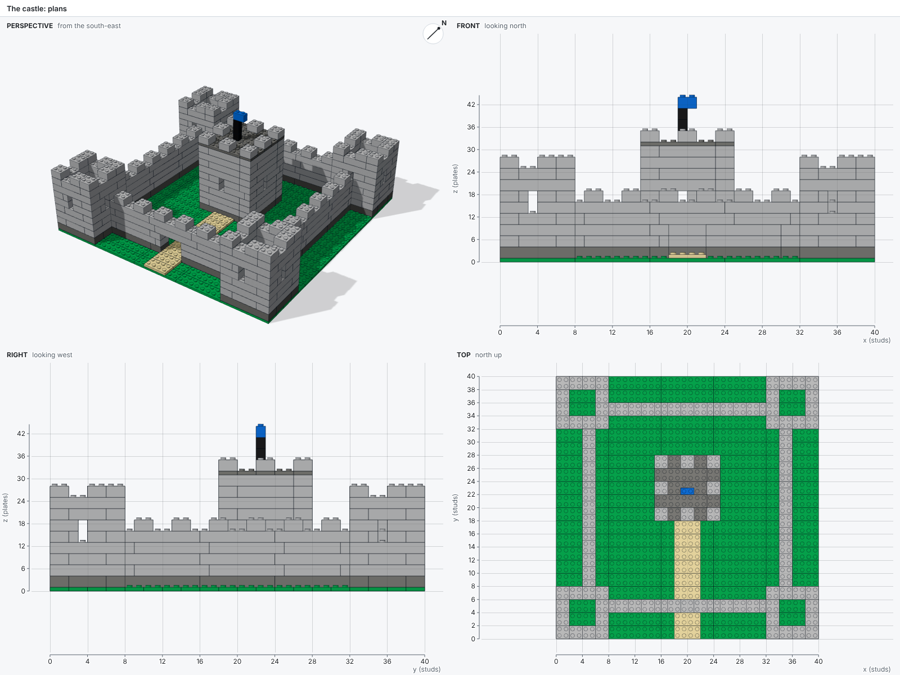
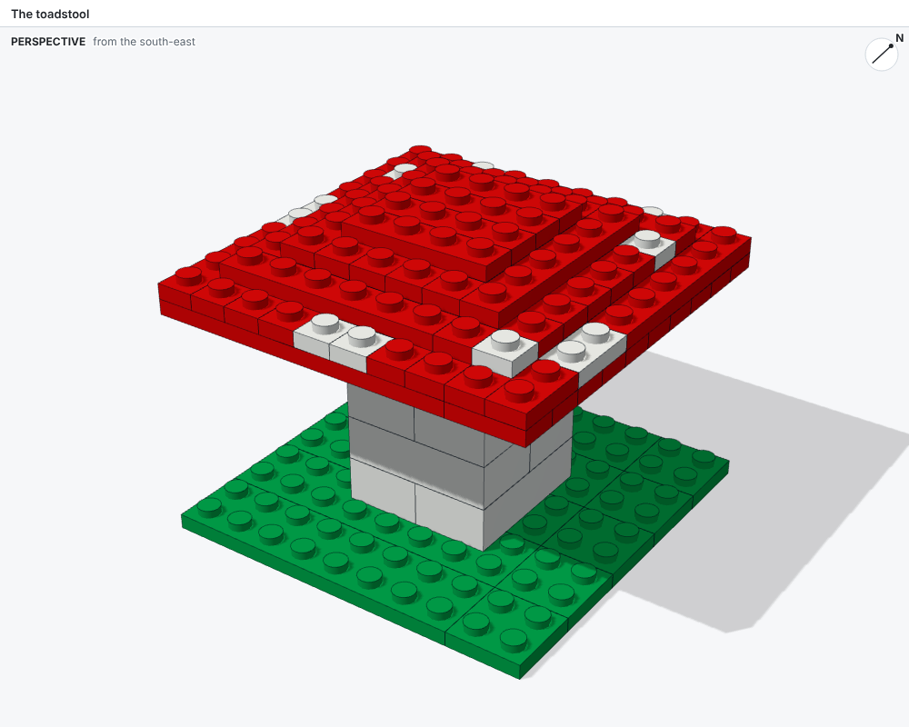
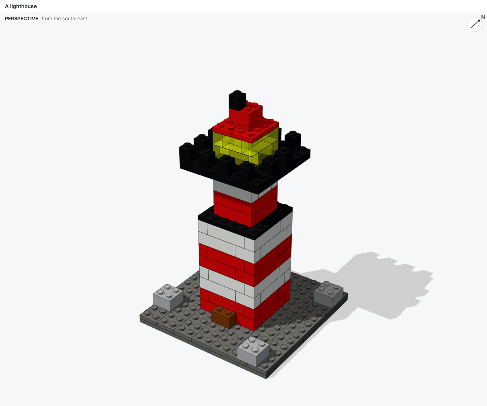
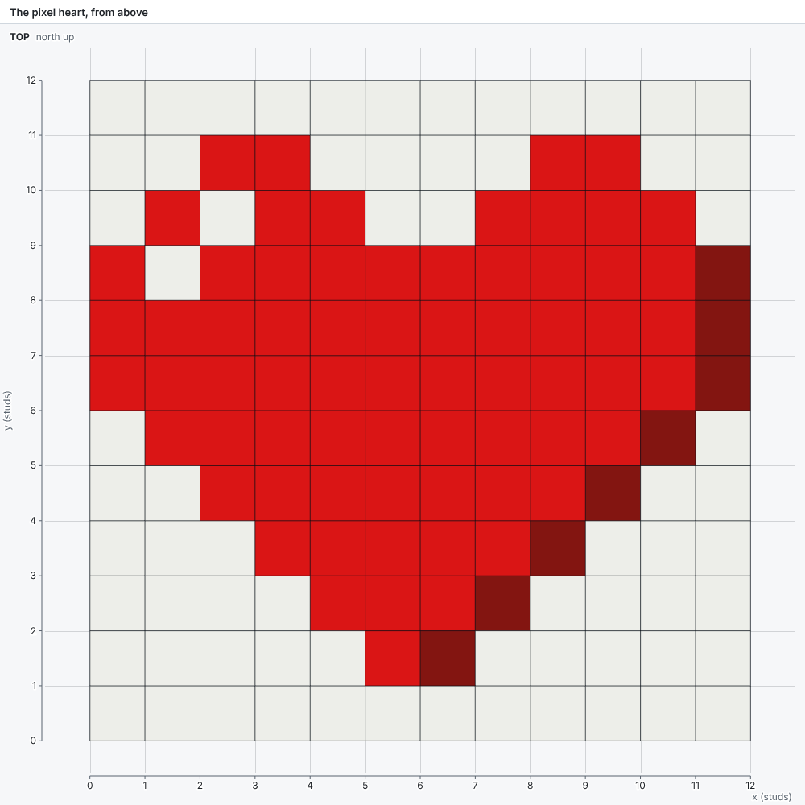

# Benchmark

Ten projects, from a brick wall to Notre-Dame de Paris, measure how well an agent builds LEGO® models with bricky.

## The projects

Each project is a prompt, sometimes with inputs: images, a plan of every layer, notes, or a broken script to repair.
Seven projects have a reference model that the agent never sees and are scored against it; the other three are open briefs, judged by eye.

| # | Project | What the agent gets | Scored |
| --- | --- | --- | --- |
| 1 | A brick wall | A precise description | Against a reference |
| 2 | A pixel heart | A 12 x 12 pixel plan and an image | Against a reference |
| 3 | Repair a footbridge | A build script with mistakes | Against a reference |
| 4 | A house from its plans | Plans with rulers: six views | Against a reference |
| 5 | A toadstool from its layers | A plan of every layer | Against a reference |
| 6 | A lighthouse from one image | One image, no measurements | Against a reference |
| 7 | A red telephone box | Notes on the K6 kiosk | Judged |
| 8 | A five-story pagoda | Notes on Tō-ji's pagoda | Judged |
| 9 | A castle from its plans | Plans with rulers, 493 elements | Against a reference |
| 10 | Notre-Dame de Paris | Notes on the cathedral | Judged |

## Inputs

Projects with plans receive images rendered from their reference, with rulers in studs and plates:

=== "House plans"

    

=== "Castle plans"

    

=== "Toadstool"

    

=== "Lighthouse"

    

=== "Pixel heart"

    

## Running it

The package `bricky-benchmark` runs the projects with Claude Code and scores the results:

```sh
uv run bricky-benchmark list                      # the projects and their inputs
uv run bricky-benchmark run --project 1           # run one project
uv run bricky-benchmark run --repeats 3 --jobs 2  # every project three times, two at a time
uv run bricky-benchmark run --model opus          # choose Claude Code's model
```

Each run needs Claude Code (`claude`) signed in, and consumes real model usage.
For every run, the runner:

1. Builds bricky's wheel and creates a fresh workspace outside the repository: a uv project that installs the wheel, with the skill, the examples and the project's inputs.
   The agent never sees the reference.
1. Starts Claude Code in that workspace in print mode, with the project's prompt, turn budget and time budget.
1. Builds the agent's final script in the same workspace and scores it.

Every run writes to `benchmark/runs/<time>/`: the transcript, the agent's log, its workspace and `record.json`, then `summary.json` and `summary.md` for the whole invocation.

## Scores

A score has three parts:

- **Facts:** whether the final script builds, its element count, and its errors and warnings.
- **Fidelity**, for projects with a reference: the voxels the two models fill, compared over every rotation about the vertical axis and the best shift.
  The `shape` score is the share of voxels filled in both models among the voxels filled in either.
  The `color` score counts a shared voxel only when its colors also match.
  A score of 1 means identical.
- **Effort:** turns, minutes, Claude Code's cost estimate, and the number of builds the agent ran.

Judged projects have facts and effort but no fidelity: their images are compared by eye.

## Results

On 28 October 2026, one Claude agent per project worked through all ten projects in a workspace like the runner's, with the command line and the skill.
The benchmark's scorer then scored the final scripts.
Every model builds with no errors and no warnings.

| # | Project | Elements | Shape | Color |
| --- | --- | ---: | ---: | ---: |
| 1 | A brick wall | 27 | 1.00 | 1.00 |
| 2 | A pixel heart | 54 | 1.00 | 1.00 |
| 3 | Repair a footbridge | 28 | 1.00 | 1.00 |
| 4 | A house from its plans | 78 | 1.00 | 1.00 |
| 5 | A toadstool from its layers | 64 | 1.00 | 1.00 |
| 6 | A lighthouse from one image | 88 | 0.93 | 0.91 |
| 7 | A red telephone box | 321 | judged | judged |
| 8 | A five-story pagoda | 596 | judged | judged |
| 9 | A castle from its plans | 401 | 1.00 | 1.00 |
| 10 | Notre-Dame de Paris | 1,872 | judged | judged |

The projects with exact plans, 1 to 5 and 9, reach a perfect score in one to four builds.
Those projects measure whether an agent can use bricky at all.
The open briefs set the difficulty.
The agents rated the lighthouse, the telephone box and the pagoda 3 out of 5, and Notre-Dame 4.
Notre-Dame earns its rating with roofs that meet at the crossing, rose windows on side studs, and walls that pack around openings without floating parts.

Since these runs, side studs sit where the real parts have them: half a stud below the top of the brick, instead of half a brick up.
With the current version, the telephone box reports 18 errors and Notre-Dame 9, all where a part hangs on a side stud a quarter plate off.
