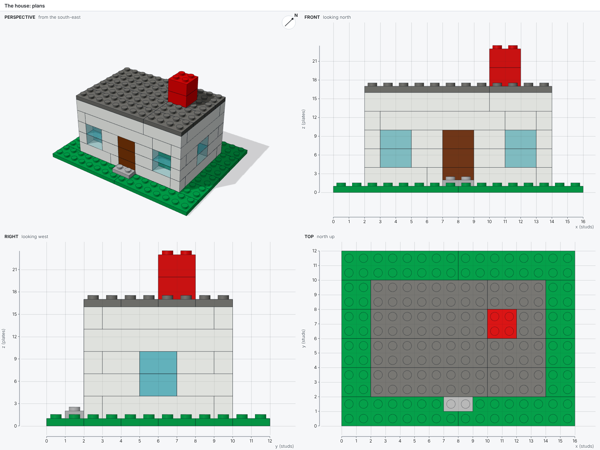

# Benchmark

Ten projects, from a brick wall to Notre-Dame de Paris, measure how well an agent builds LEGO® models with bricky.
Each project is a prompt, sometimes with inputs: pictures, a voxel-by-voxel plan, notes, or a broken script to repair.
Seven have a reference model the agent never sees and are scored against it; the other three are open briefs, judged by looking at the result.

| # | Project | What the agent gets | Scored |
| --- | --- | --- | --- |
| 1 | A brick wall | A precise description | Against a reference |
| 2 | A pixel heart | A 12 x 12 pixel plan and a picture | Against a reference |
| 3 | Repair a footbridge | A build script with mistakes | Against a reference |
| 4 | A house from its plans | Plans with rulers: six views | Against a reference |
| 5 | A toadstool from its layers | A plan of every plate level | Against a reference |
| 6 | A lighthouse from one picture | One picture, no measurements | Against a reference |
| 7 | A red telephone box | Notes on the K6 kiosk | Judged |
| 8 | A five-story pagoda | Notes on Tō-ji's pagoda | Judged |
| 9 | A castle from its plans | Plans with rulers, 493 elements | Against a reference |
| 10 | Notre-Dame de Paris | Notes on the cathedral | Judged |

## Inputs

Projects with plans get pictures drawn from the reference, with rulers in studs and plates:

=== "House plans"

    

=== "Castle plans"

    

=== "Toadstool"

    

=== "Lighthouse"

    

=== "Pixel heart"

    

## Running it

```sh
uv run bricky-bench list                     # the projects and their inputs
uv run bricky-bench run --project 1          # run one project with Claude Code
uv run bricky-bench run --repeats 3 --jobs 2 # every project three times, two at a time
uv run bricky-bench run --model opus         # choose Claude Code's model
```

Each run needs Claude Code (`claude`) signed in, and costs real model usage.
For every run, the runner:

1. Builds bricky's wheel and makes a fresh workspace outside the repository: a uv project that installs the wheel, plus the skill, the example scripts and the project's inputs.
   The agent never sees the reference.
1. Starts Claude Code there in print mode with the project's prompt, turn budget and time budget.
1. Builds the agent's final script in the same workspace and scores it.

Everything lands in `bench/runs/<time>/`: per run, the transcript, the agent's log, its workspace and `record.json`; per invocation, `summary.json` and `summary.md`.

## Scores

- **Facts:** whether the final script builds, its element count, and its errors and warnings.
- **Fidelity**, for projects with a reference: the voxels the two models fill, compared over every rotation about the vertical axis and the best shift.
  `shape` is the share of voxels filled in both models among voxels filled in either; `color` counts a shared voxel only when the colors match too.
  1 is identical.
- **Effort:** turns, minutes, Claude Code's cost estimate, and how many builds the agent ran.

Judged projects have facts and effort but no fidelity: compare their pictures by eye.

## First results

On 28 October 2026, one Claude agent per project worked through all ten in a workspace like the runner's, with the command line and the skill, and `bricky-bench`'s scorer scored the final scripts.
Every model builds with no errors and no warnings.

| # | Project | Elements | Shape | Color |
| --- | --- | ---: | ---: | ---: |
| 1 | A brick wall | 27 | 1.00 | 1.00 |
| 2 | A pixel heart | 54 | 1.00 | 1.00 |
| 3 | Repair a footbridge | 28 | 1.00 | 1.00 |
| 4 | A house from its plans | 78 | 1.00 | 1.00 |
| 5 | A toadstool from its layers | 64 | 1.00 | 1.00 |
| 6 | A lighthouse from one picture | 88 | 0.93 | 0.91 |
| 7 | A red telephone box | 321 | judged | judged |
| 8 | A five-story pagoda | 596 | judged | judged |
| 9 | A castle from its plans | 401 | 1.00 | 1.00 |
| 10 | Notre-Dame de Paris | 1,872 | judged | judged |

The projects with exact plans, 1 to 5 and 9, reach a perfect score in one to four builds, so they measure whether an agent can use bricky at all.
The open briefs set the difficulty: the agents rated the lighthouse, the telephone box and the pagoda 3 out of 5, and Notre-Dame 4, for its roofs meeting at the crossing, its rose windows on side studs, and walls that pack around openings without floating parts.

Since these runs, bricky has moved the studs on the sides of bricks to where the real parts have them: half a stud below the top, where they stood half a brick up before.
Under the current version, the telephone box reports 18 errors and Notre-Dame 9, all where a part hangs on a side stud a quarter plate off.
