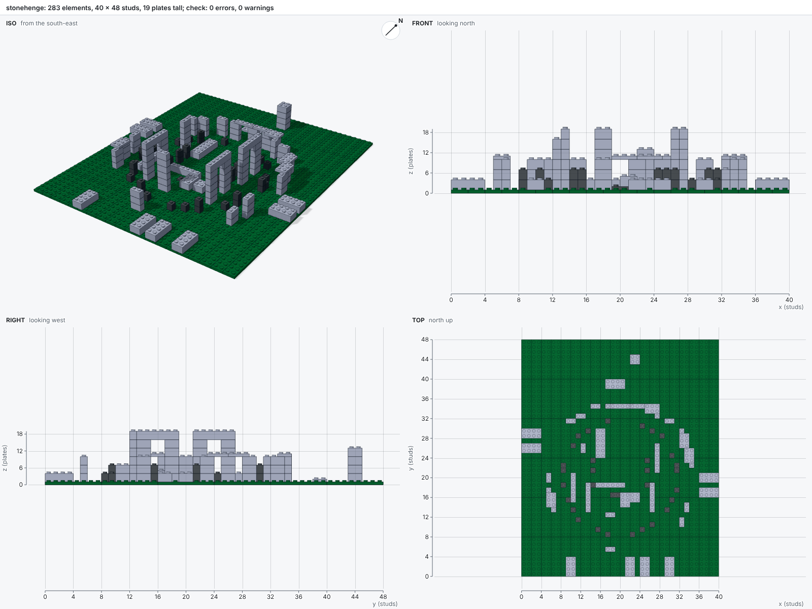
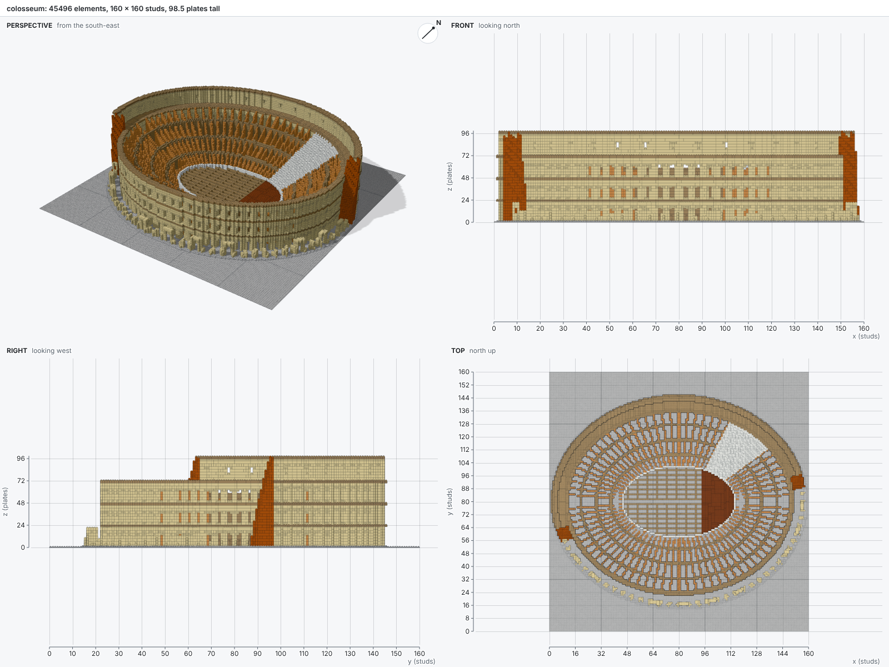

# Examples

The scripts in [`examples/`](https://github.com/maxencefaldor/bricky/tree/main/examples) build
models of growing size. Each one builds with one command:

```sh
uv run bricky build examples/stonehenge.py
```

## Tower

`examples/tower.py`: crossed courses of bricks 2 x 4, each level rotated a quarter turn so every
brick bridges the two below it, capped with tiles.


## Colonnade

`examples/colonnade.py`: one column component, instanced four times, under a two-layer beam. A
change to the component changes every column.


## Cottage

`examples/cottage.py`: walls in running bond, an arch over the door, a roof of slopes with a ridge
of cheese slopes, a sign held sideways by a side stud, a lamp post on a jumper, and a round bush.


## Stonehenge

`examples/stonehenge.py`: the sarsen circle with its lintels, the horseshoe of trilithons, the
bluestones and the heel stone, from measurements of the monument.



## Elizabeth Tower

`examples/elizabeth_tower.py`: Big Ben's tower, voxelized from its measurements and covered layer
by layer with the biggest parts that fit, every part resting on the layer below.


## Colosseum

`examples/colosseum.py`: the Colosseum in Rome at 1:150, 45,496 elements on a plaza of 25
baseplates. Functions draw the monument as voxels on elliptical rings, and `builder.fill` lays
them in bricks and plates:

- the outer ring's three arcades, the attic with its pilasters, windows and corbels, and the crown;
- the ruined south side, where the second ring's arcades show behind broken piers;
- brick buttresses at both ends of the surviving outer ring;
- the radial and ring walls of the seating, with one sector rebuilt in marble;
- the podium, the hypogeum's walls, and a wooden stage over the east end.

Round bricks stand for the half-columns at every pier. A build takes about a minute: the script
15 seconds, the check 6 and the pictures 35.




## Broken

`examples/broken.py`: one mistake of each kind the checks catch, to show what bricky reports.


