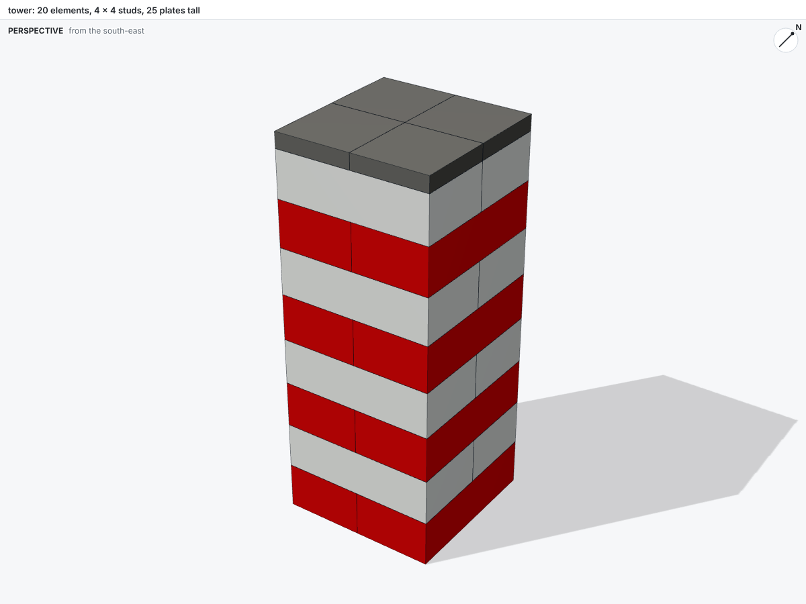
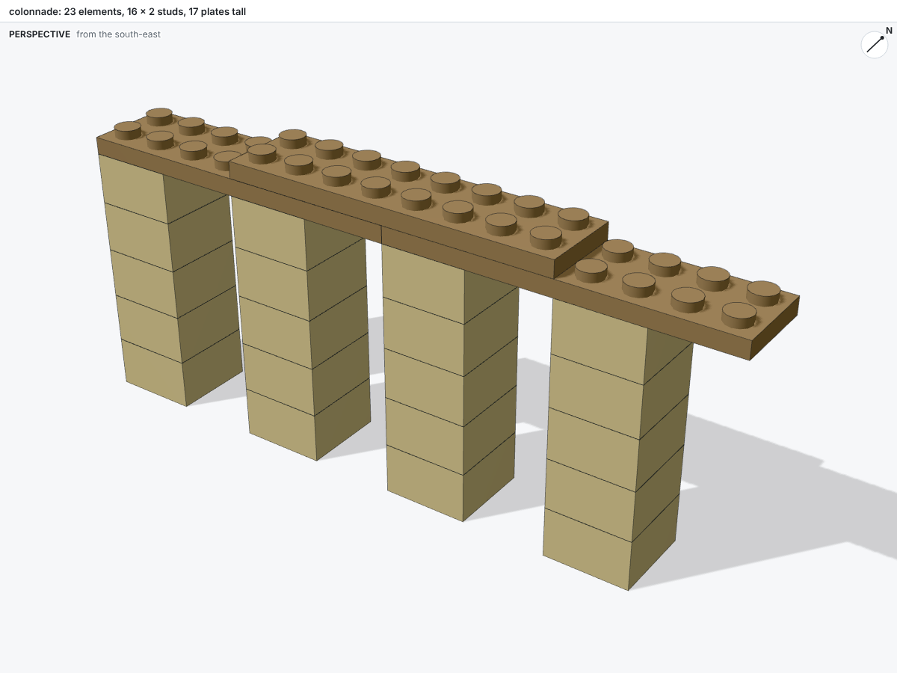
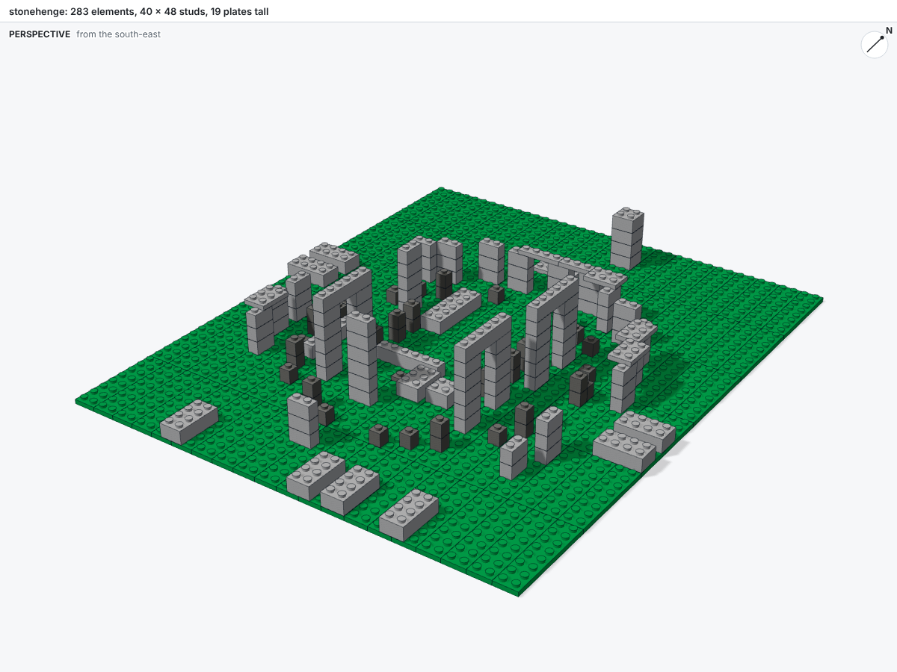

---
hide:
  - toc
---

# Gallery

The examples in [`examples/`](https://github.com/maxencefaldor/bricky/tree/main/examples) each build with one command, and each opens here in a 3D viewer to orbit, zoom and clip.

<div class="grid cards bricky-cards bricky-gallery" markdown>

-   

    **[Tower](gallery/tower.html)** · 20 elements

    Crossed courses of bricks 2 x 4, each rotated 90 degrees so every brick bridges the two below.

    [Open in 3D](gallery/tower.html) · [Script](https://github.com/maxencefaldor/bricky/blob/main/examples/tower.py)

-   

    **[Colonnade](gallery/colonnade.html)** · 23 elements

    One column component, placed four times under a beam of two layers.

    [Open in 3D](gallery/colonnade.html) · [Script](https://github.com/maxencefaldor/bricky/blob/main/examples/colonnade.py)

-   

    **[Cottage](gallery/cottage.html)** · 110 elements

    Walls in running bond, an arch, a roof of slopes, a sign on a side stud and a lamp post on a jumper.

    [Open in 3D](gallery/cottage.html) · [Script](https://github.com/maxencefaldor/bricky/blob/main/examples/cottage.py)

-   

    **[Stonehenge](gallery/stonehenge.html)** · 283 elements

    The sarsen circle, the horseshoe of trilithons and the bluestones, from measurements of the monument.

    [Open in 3D](gallery/stonehenge.html) · [Script](https://github.com/maxencefaldor/bricky/blob/main/examples/stonehenge.py)

-   

    **[Elizabeth Tower](gallery/elizabeth-tower.html)** · 1,526 elements

    Big Ben's tower, described as voxels and filled with bricks and plates.

    [Open in 3D](gallery/elizabeth-tower.html) · [Script](https://github.com/maxencefaldor/bricky/blob/main/examples/elizabeth_tower.py)

-   

    **[Colosseum](gallery/colosseum.html)** · 44,968 elements

    Rome's amphitheater at 1:150, filled from 242,576 voxels, with its ruined south side and hypogeum.

    [Open in 3D](gallery/colosseum.html) · [Script](https://github.com/maxencefaldor/bricky/blob/main/examples/colosseum.py)

</div>

To build an example and open its viewer locally:

```sh
uv run bricky build examples/stonehenge.py
uv run bricky render examples/stonehenge.bricky.json --html
```
