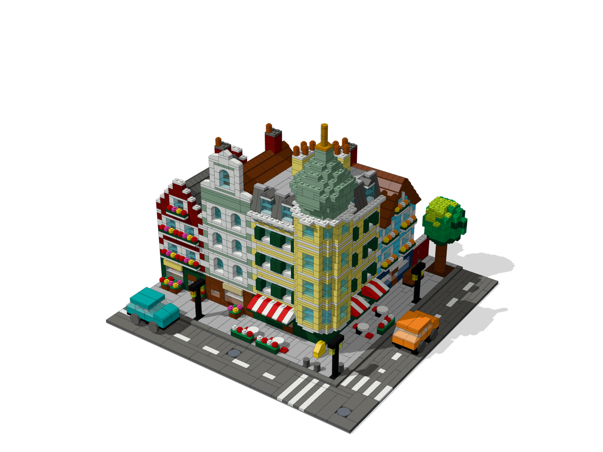
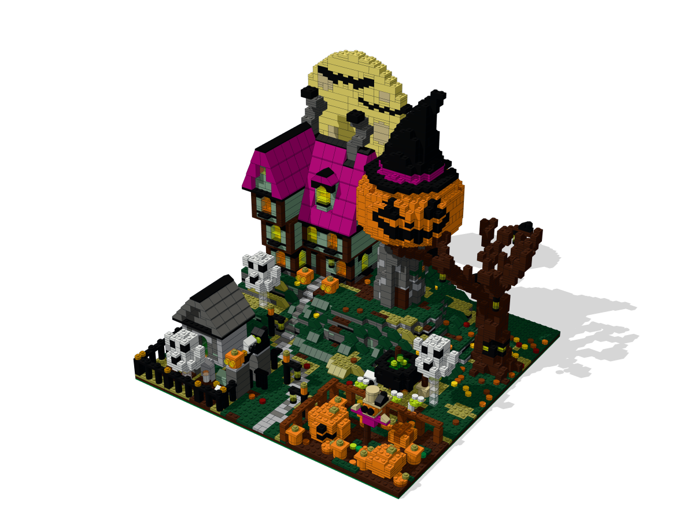
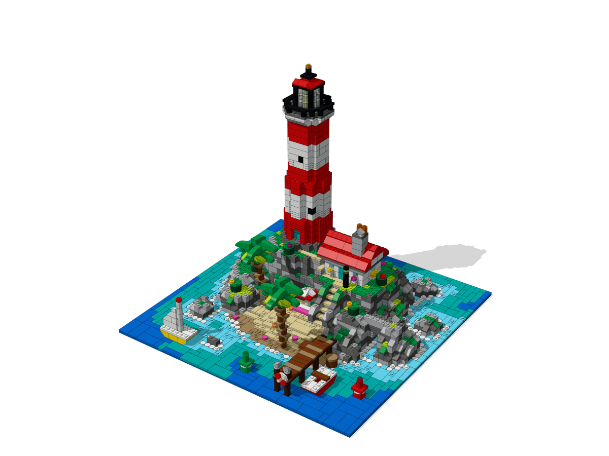
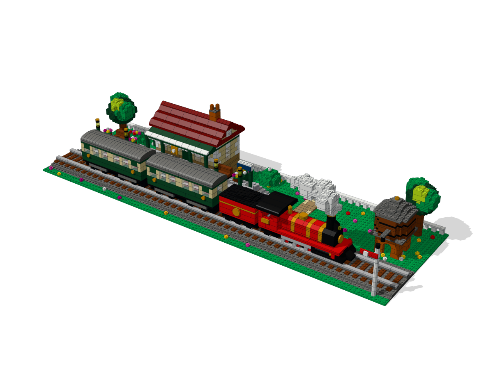
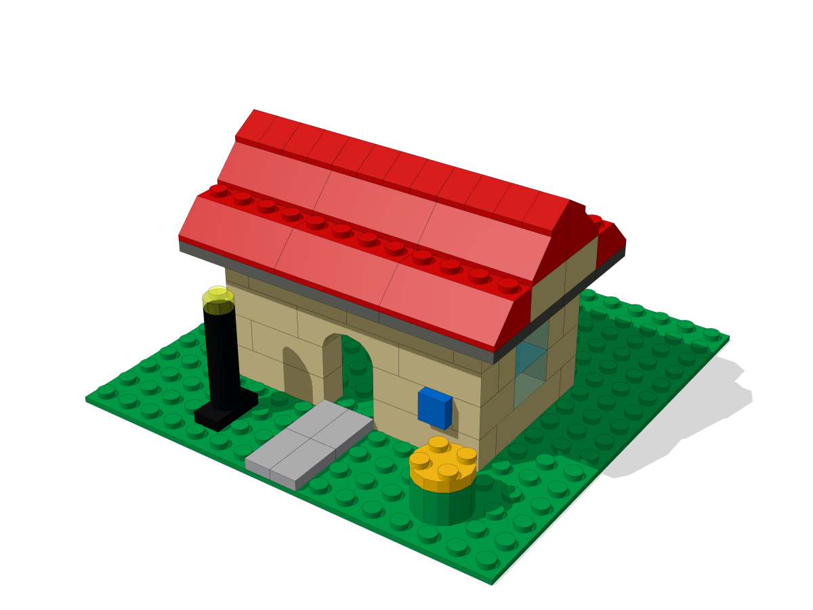
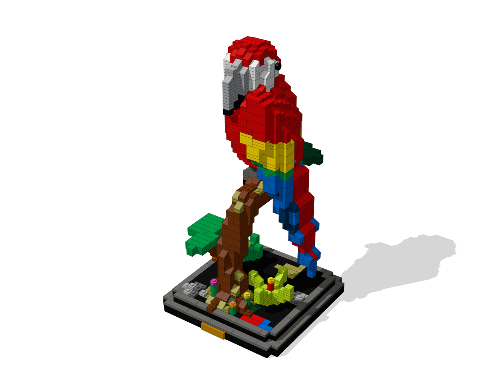
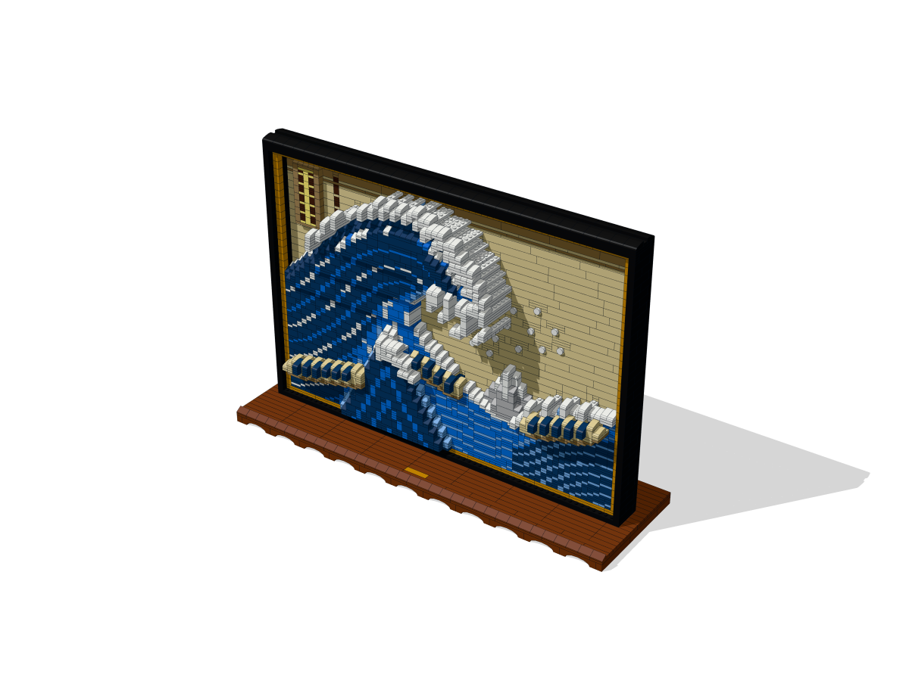
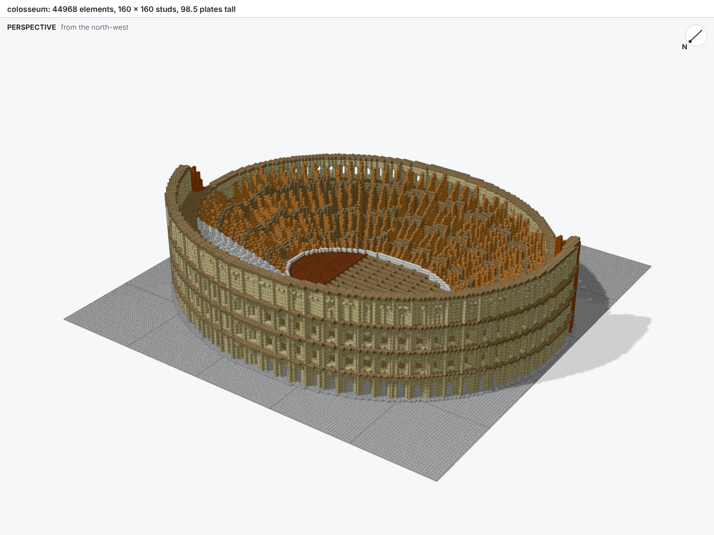

# Gallery

The models below each build with one command from [`examples/`](https://github.com/maxencefaldor/bricky/tree/main/examples), and each opens in a 3D viewer to orbit, zoom and clip.

## Scenes

Each scene sets a subject in its surroundings, with the details that make it lively.

<div class="grid cards bricky-cards bricky-gallery" markdown>

-   

    **[Japanese garden](gallery/japanese-garden.html)** · 4,501 elements

    A five-story pagoda, a vermilion torii and cherry trees in bloom surround a koi pond under an arched bridge.
    Inverted slopes flare the eaves, and filled voxels grow the blossoms.

    [Open in 3D](gallery/japanese-garden.html) · [Script](https://github.com/maxencefaldor/bricky/blob/main/examples/japanese_garden.py)

-   

    **[Street corner](gallery/street-corner.html)** · 3,372 elements

    Four townhouses meet at a corner café with a turret, an onion dome and striped awnings.
    Components place the windows, doors, shop fronts, awnings, signs and dormers 76 times.

    [Open in 3D](gallery/street-corner.html) · [Script](https://github.com/maxencefaldor/bricky/blob/main/examples/street_corner.py)

-   

    **[Pirate ship](gallery/pirate-ship.html)** · 4,036 elements

    A three-masted galleon flies a Jolly Roger over a choppy sea.
    Side studs hold the cannons and the anchor, and jumpers center the topmasts.

    [Open in 3D](gallery/pirate-ship.html) · [Script](https://github.com/maxencefaldor/bricky/blob/main/examples/pirate_ship.py)

-   

    **[Pumpkin manor](gallery/pumpkin-manor.html)** · 5,325 elements

    A crooked manor rises on a twisted hill, its tower a giant jack-o'-lantern in a witch's hat, before a full moon crossed by bats.
    Ghosts haunt the graveyard, a scarecrow guards the pumpkins, and a cauldron bubbles green.

    [Open in 3D](gallery/pumpkin-manor.html) · [Script](https://github.com/maxencefaldor/bricky/blob/main/examples/pumpkin_manor.py)

-   

    **[Lighthouse island](gallery/lighthouse-island.html)** · 2,638 elements

    A red and white lighthouse stands on rocks filled from voxels, above a keeper's cottage, a beach of palms and a pier with moored boats.

    [Open in 3D](gallery/lighthouse-island.html) · [Script](https://github.com/maxencefaldor/bricky/blob/main/examples/lighthouse_island.py)

-   

    **[Steam train](gallery/steam-train.html)** · 2,587 elements

    A locomotive, its tender and two carriages wait at a country station with a clock and a water tower.
    Round plates on side studs make the wheels, and one component makes both carriages.

    [Open in 3D](gallery/steam-train.html) · [Script](https://github.com/maxencefaldor/bricky/blob/main/examples/steam_train.py)

-   

    **[Cottage](gallery/cottage.html)** · 110 elements

    Walls in running bond, an arch, a roof of slopes, a sign on a side stud and a lamp post on a jumper.

    [Open in 3D](gallery/cottage.html) · [Script](https://github.com/maxencefaldor/bricky/blob/main/examples/cottage.py)

</div>

## Sculptures and art

Each sculpture shapes its subject from voxels, so curves come out of the same bricks and plates as walls.

<div class="grid cards bricky-cards bricky-gallery" markdown>

-   

    **[Macaw](gallery/macaw.html)** · 1,421 elements

    A scarlet macaw perches on a branch above a display base.
    Filled voxels shape the bird, and crossed plates build its tail and leaves.

    [Open in 3D](gallery/macaw.html) · [Script](https://github.com/maxencefaldor/bricky/blob/main/examples/macaw.py)

-   

    **[The Great Wave](gallery/great-wave.html)** · 5,224 elements

    Hokusai's print stands framed as a relief: each pixel has a color and a depth, and the crest's claws of foam reach past the frame.

    [Open in 3D](gallery/great-wave.html) · [Script](https://github.com/maxencefaldor/bricky/blob/main/examples/great_wave.py)

</div>

## Landmarks

Each landmark rebuilds a real building at scale, with the details that make it recognizable.

<div class="grid cards bricky-cards bricky-gallery" markdown>

-   

    **[Elizabeth Tower](gallery/elizabeth-tower.html)** · 10,683 elements

    Big Ben's tower rises 301 plates over Bridge Street, beside the Palace of Westminster, with red buses and a black cab at its foot.
    Its blue and gold dials are built sideways on side studs, under a belfry and a spire of gilded slopes.

    [Open in 3D](gallery/elizabeth-tower.html) · [Script](https://github.com/maxencefaldor/bricky/blob/main/examples/elizabeth_tower.py)

-   

    **[Colosseum](gallery/colosseum.html)** · 44,968 elements

    Rome's amphitheater at 1:150, filled from 273,616 voxels, with its ruined south side and hypogeum.

    [Open in 3D](gallery/colosseum.html) · [Script](https://github.com/maxencefaldor/bricky/blob/main/examples/colosseum.py)

</div>

## Build one

To build an example and write its viewer, `examples/japanese_garden.html`:

```sh
uv run bricky build examples/japanese_garden.py
uv run bricky render examples/japanese_garden.bricky.json --html
```
