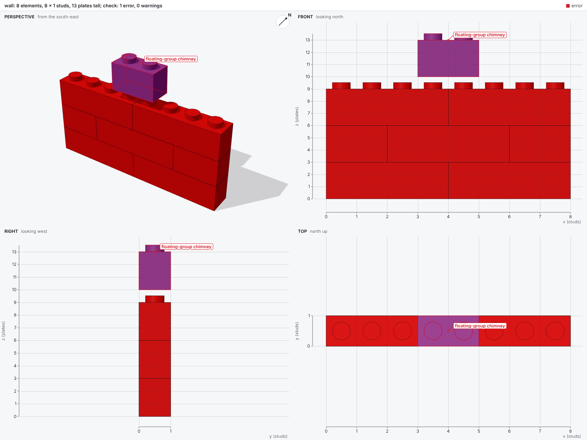
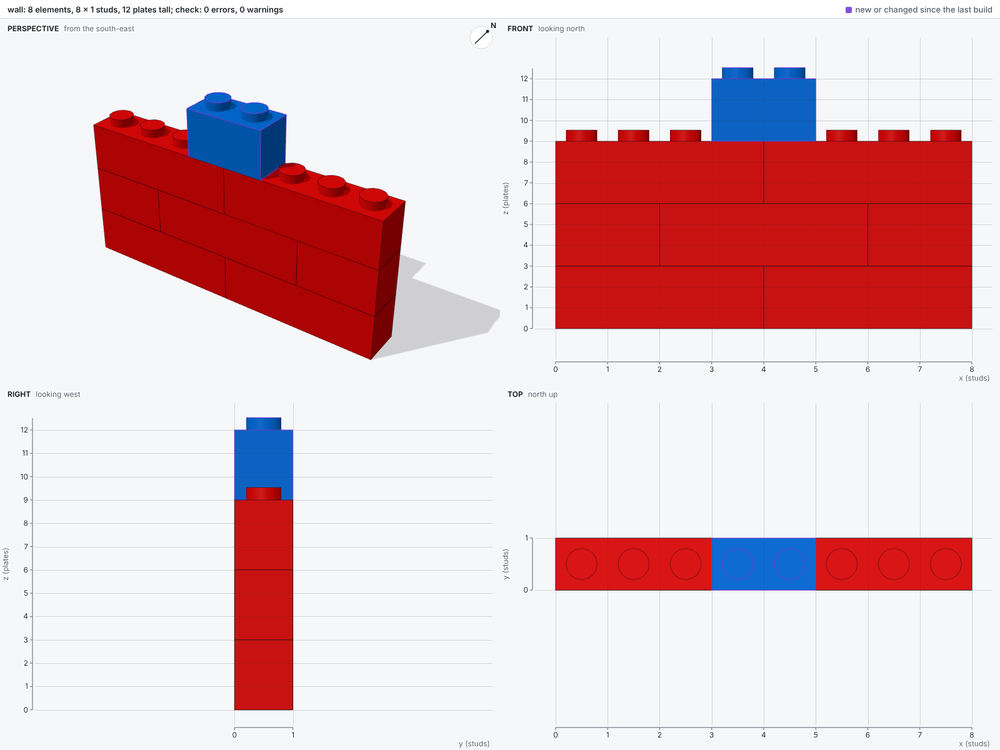

# Get started

The tutorial builds a small wall with one mistake, then fixes it, and shows the report and the image of each build.

## Install

A [uv](https://docs.astral.sh/uv/) project holds the tutorial's build scripts, and uv installs Python 3.12 or newer if needed:

```sh
uv init --bare my-models && cd my-models  # a project for your build scripts
uv add bricky                             # bricky and every dependency, from PyPI
uv run playwright install chromium        # the browser bricky renders in, once per machine
uv run bricky --version                   # the installed version
```

Playwright's Chromium renders the images.
On Linux, `uv run playwright install --with-deps chromium` also installs the browser's system libraries.
To render with a Chromium already on the machine, set `BRICKY_RENDER_BROWSER` to its executable instead (see [Configuration](reference/configuration.md)).

With pip, run `pip install bricky` and then `playwright install chromium`.
To install bricky as a tool, run `uv tool install bricky --with-executables-from playwright`, then `playwright install chromium`.
The command is then `bricky`, without `uv run`, wherever the docs write `uv run bricky`.

A clone of the repository runs every example and the benchmark, and is the way to work on bricky:

```sh
git clone https://github.com/maxencefaldor/bricky && cd bricky
uv sync
uv run playwright install chromium
```

## Write a build script

A build script is a Python file whose `build()` returns a `ModelBuilder`.
Create a folder `models/` and save this wall as `models/wall.py`:

```python title="models/wall.py"
from bricky import ModelBuilder


def build() -> ModelBuilder:
    builder = ModelBuilder("wall")
    for course in range(3):
        z = 3 * course  # a brick is three plates tall
        if course % 2 == 0:  # two bricks 1 x 4
            builder.place("3010", at=(0, 0, z), rotation="R90", color="Red")
            builder.place("3010", at=(4, 0, z), rotation="R90", color="Red")
        else:  # offset joints: a brick 1 x 4 between two bricks 1 x 2
            builder.place("3004", at=(0, 0, z), rotation="R90", color="Red")
            builder.place("3010", at=(2, 0, z), rotation="R90", color="Red")
            builder.place("3004", at=(6, 0, z), rotation="R90", color="Red")
    builder.place("3004", at=(3, 0, 10), rotation="R90", color="Blue", id="chimney")
    return builder
```

Each call to `place` names a part, the corner `at` where it goes, a rotation and a color.
The corner reads `(x, y, z)`: east and north in studs, up in plates.
Unrotated, a Brick 1 x 4 runs north, along y; the rotation `R90` rotates it 90 degrees so it runs east.
The last call gives the blue brick an id, so the report and the images name it.

## Build it

```sh
uv run bricky build models/wall.py
```

The build runs the script in a process of its own, then saves, checks and renders the model.
The report opens with the model's size and then states what is wrong.
The report's last line, the time each step took, is left out of the outputs below:

```text
saved models/wall.bricky.json: 8 elements, 8 x 1 studs, 13 plates tall

error[E301]: 1 element floats: no chain of stud connections leads to the ground
  --> x 3..5  y 0..1  z 10..13
   = chimney: Brick 1 x 2 (3004), Blue, models/wall.py:15 in build()

by source line:
  models/wall.py:15 in build(): 1 diagnostic

checked 8 elements with profile digital (schema, collision, connectivity): 1 error, 0 warnings

rendered (open the images to see the model):
  sheet: models/wall.png
```

The diagnostic states one fact: the blue brick floats.
The top course ends at z = 9 and the brick starts at z = 10, one plate higher, so no stud holds it.
The region after `-->` says where, in studs and plates.
The line after `=` names the element, its part, its color and the script line that placed it.

The sheet shows the same fact: it tints the floating brick red and labels it with its code.



The front and right views carry rulers in the units of `at`, so the one-plate gap reads straight off the z ruler.

## Fix it

Lower the chimney onto the top course, at z = 9:

```python
builder.place("3004", at=(3, 0, 9), rotation="R90", color="Blue", id="chimney")
```

Build again.
The report now opens with what changed since the last build:

```text
saved models/wall.bricky.json: 8 elements, 8 x 1 studs, 12 plates tall

since the last build: 0 added, 0 removed, 1 changed, 7 unchanged
  voxels: 2 filled, 2 emptied, 0 recolored
  changed at:
    models/wall.py:15 in build(): 1 element

checked 8 elements with profile digital (schema, collision, connectivity): 0 errors, 0 warnings

rendered (open the images to see the model):
  sheet: models/wall.png
```

One element changed, placed by line 15, and nothing else moved.
The model has no errors, and the sheet outlines the changed brick in purple:



## Next steps

Four sections of the docs go further than the tutorial:

<div class="grid cards bricky-links" markdown>

-   📘 **[Guide](guide/index.md)**

    Each step of the tutorial in depth, one concept per page, starting with coordinates.

-   🤖 **[Agents](agents/index.md)**

    Hand the loop to an agent through the command line, the MCP server or the skill.

-   🖼️ **[Gallery](gallery.md)**

    Larger models in a 3D viewer, from a steam train to the Colosseum, each with its script.

-   📚 **[Reference](reference/index.md)**

    Every command, diagnostic code and setting, including the ones the tutorial used.

</div>
