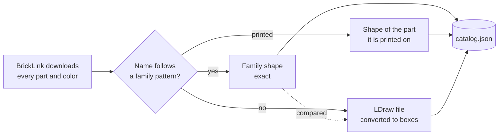

# The catalog

bricky knows parts and colors by their BrickLink ids.
A catalog is built from two sources, each for what it does best, and every part records where its shape came from.



- **BrickLink**, the LEGO Group's marketplace, lists every part and color: ids, names, categories, RGB values, and the colors each part comes in.
- **Names.**
  A part whose official name follows a family pattern gets that family's exact shape: "Slope 45 2 x 4" is a slope two studs deep and four wide, "Brick 1 x 2 x 2" a brick two bricks tall.
  A slope's run follows from its angle and height.
- **Printed parts** take the shape of the part they are printed on.
- **LDraw.**
  Every other part with an LDraw file is converted from the [LDraw.org Parts Library](https://library.ldraw.org) (CC BY 4.0): its body as boxes on a 0.8 mm grid, its studs where LDraw draws them, and its anti-studs wherever the underside leaves room for a stud.

Where a part has both a family shape and an LDraw file, the import compares their sizes, studs and anti-studs.
They agree for almost every part, which checks both, and the import reports every disagreement:

- Where LDraw's shape only lacks anti-studs the name gives, the part keeps its name's shape.
  The conversion finds anti-studs by the room under a body on a 0.8 mm grid, which misses sockets under thin and curved bodies, such as those of curved slopes.
- Otherwise the name has hidden a detail that changes the part, so the part takes LDraw's shape, rotated to the name's orientation where a rotation brings the two closer.

## Importing

BrickLink's catalog downloads come from <https://www.bricklink.com/catalogDownload.asp>, signed in, as XML: Catalog Items (item type Parts), Colors, Categories and Codes, saved in one folder under any names.
The LDraw library is the unzipped `complete.zip` from library.ldraw.org.

```sh
uv run bricky catalog import --bricklink ~/bricklink --ldraw ~/ldraw   # either, or both
uv run bricky catalog status               # which catalog is in use, and what it holds
uv run bricky catalog show 3001 --render   # one part: its facts, its shape and a picture
uv run bricky catalog verify               # generate every shaped part's geometry and check it
```

The import writes `catalog.json` to bricky's data folder, outside any repository, and bricky uses it from then on.
Without BrickLink's downloads, parts come from LDraw alone, named as LDraw names them, and colors come from the sample.
Set `catalog` in `[tool.bricky]`, or `BRICKY_CATALOG`, to use another catalog file.

## What an import finds

The import of BrickLink's October 2026 catalog with LDraw's 2026-10 release takes six and a half minutes on two cores and reports:

```text
imported 97,099 parts and 214 colors from:
  BrickLink catalog downloads of 2026-10-28
  LDraw.org Parts Library, CC BY, release 2026-10

47,682 parts have a shape and can be placed; 49,417 have none
shapes by source: printed 41,975, LDraw 5,503, name 204
shapes by family: boxes 28,062, tile 10,098, brick 3,840, slope 1,971, round 1,779, ...

parts without a shape, by category (most first):
  Minifigure, Torso Assembly, Decor.: 7,415
  Minifigure, Torso: 7,029
  Sticker Sheet: 5,018
  Minifigure, Head: 4,357
  ...

LDraw files that could not be converted, by reason:
  encloses no volume: 28

compared 179 named shapes with LDraw: 20 disagreements
  2875 Slope 45 2 x 6 x 2/3 takes LDraw's shape: its name gives 40 x 120 x 16 units,
    6 studs, 12 anti-studs; LDraw gives 40 x 120 x 24 units, 6 studs, 10 anti-studs
  15068 Slope, Curved 2 x 2 x 2/3 keeps its name's shape: its name gives 40 x 40 x 16 units,
    0 studs, 4 anti-studs; LDraw gives 40 x 40 x 16 units, 0 studs, 2 anti-studs
  ...
```

Parts without a shape stay in the catalog: `bricky parts --shapeless` finds them, but they cannot be placed.
Most are minifigure parts, stickers and DUPLO, which no family describes and LDraw draws as surfaces without volume.

## Converted parts

A converted part keeps LDraw's orientation, or the name's orientation where it replaces a named shape; its note says which.
Its body is exact on the 0.8 mm grid, which holds every wall, height and stud of ordinary parts; curved surfaces become steps.


## The sample

Until a catalog is imported, bricky uses a sample of 112 common parts and 40 colors, written from BrickLink's real downloads and checked against LDraw.
Tests and examples use the sample, so they run anywhere.
