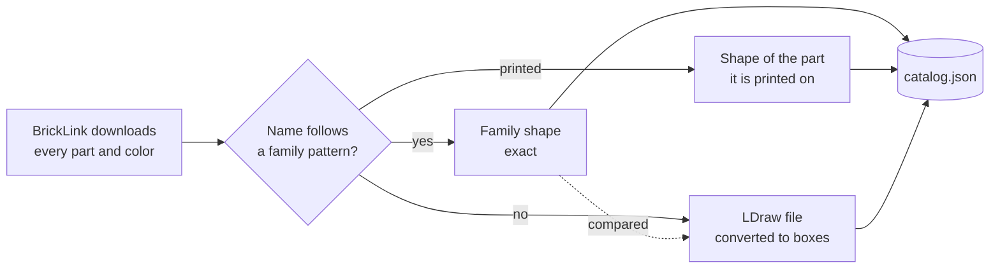

# Catalog

The catalog holds every part and color bricky knows: BrickLink supplies ids, names and colors, and names or LDraw supply shapes.

## The sample

Until a catalog is imported, bricky uses a sample of 112 common parts and 40 colors.
The sample comes from BrickLink's real downloads, checked against LDraw.
The sample ships with the package, so tests and examples run anywhere.

## Two sources

BrickLink, the LEGO Group's marketplace, lists every part and color; the LDraw.org Parts Library describes the geometry of parts whose names give no shape.
Each part takes its shape from the most exact source that describes it, and records which one:



- **BrickLink** supplies ids, names, categories, RGB values, and the colors each part comes in.
- **Names** give exact shapes: a part whose official name follows a family pattern gets that family's shape.
  The name "Slope 45 2 x 4" describes a slope two studs deep and four wide.
  The name "Brick 1 x 2 x 2" describes a brick two bricks tall.
- **Printed parts** take the shape of the part they are printed on.
- **LDraw** shapes every other part, converted from the [LDraw.org Parts Library](https://library.ldraw.org) under CC BY 4.0.
  The conversion keeps the body as boxes on a 0.8 mm grid and the studs where LDraw places them.
  Anti-studs go wherever the underside leaves room for a stud.

Where a part has both a family shape and an LDraw file, the import compares their sizes, studs and anti-studs, and reports every disagreement.
The two agree for 159 of 179 parts, so each source checks the other.
Where LDraw's shape lacks only anti-studs that the name gives, the part keeps the name's shape.
The conversion misses anti-studs under thin and curved bodies.
Any other disagreement means the name misses a detail, so the part takes LDraw's shape.
The import rotates that shape to the name's orientation when a rotation brings the two closer.

## Importing

The import reads BrickLink's catalog downloads, LDraw's library, or both:

- **BrickLink:** Sign in at <https://www.bricklink.com/catalogDownload.asp>, then download Catalog Items (item type Parts), Colors, Categories and Codes as XML into one folder.
- **LDraw:** Unzip `complete.zip` from library.ldraw.org, and pass the unzipped `ldraw` folder to `--ldraw`.

```sh
uv run bricky catalog import --bricklink ~/bricklink --ldraw ~/ldraw
uv run bricky catalog status              # the catalog in use, and what it holds
uv run bricky catalog show 3001 --render  # one part: its facts, its shape and an image
uv run bricky catalog verify              # generate and check every shaped part
```

The import writes `catalog.json` to bricky's data folder, outside any repository, and every command uses it from then on.
The data folder is `~/.local/share/bricky` on Linux, `~/Library/Application Support/bricky` on macOS and `%LOCALAPPDATA%\bricky` on Windows.
The command `bricky catalog status` prints the path of the catalog in use.
Without BrickLink's downloads, parts come from LDraw alone, under LDraw's names, and colors come from the sample.
To use another catalog file, set `catalog` in `[tool.bricky]` or the variable `BRICKY_CATALOG` (see [Configuration](../reference/configuration.md)).

## What an import finds

The import of BrickLink's October 2026 catalog with LDraw's 2026-10 release takes six and a half minutes on two cores and reports:

```text
imported 97,099 parts and 214 colors from:
  BrickLink catalog downloads of 2026-10-28
  LDraw.org Parts Library, CC BY, release 2026-10

47,682 parts have a shape and can be placed; 49,417 have none
shapes by source: printed 41,975, LDraw 5,503, name 204
shapes by family: boxes 28,062, tile 10,098, brick 3,840, slope 1,971, round 1,779, ...

parts without a shape, by category (most first):
  Minifigure, Torso Assembly, Decor.: 7,415
  Minifigure, Torso: 7,029
  Sticker Sheet: 5,018
  Minifigure, Head: 4,357
  ...

LDraw files that could not be converted, by reason:
  encloses no volume: 28

compared 179 named shapes with LDraw: 20 disagreements
  2875 Slope 45 2 x 6 x 2/3 takes LDraw's shape: its name gives 40 x 120 x 16 units,
    6 studs, 12 anti-studs; LDraw gives 40 x 120 x 24 units, 6 studs, 10 anti-studs
  15068 Slope, Curved 2 x 2 x 2/3 keeps its name's shape: its name gives 40 x 40 x 16 units,
    0 studs, 4 anti-studs; LDraw gives 40 x 40 x 16 units, 0 studs, 2 anti-studs
  ...
```

Parts without a shape stay in the catalog, and `bricky parts --shapeless` finds them, but no script can place them.
Most are minifigure parts, stickers and DUPLO, which no family describes and LDraw models as surfaces without volume.
A converted part keeps LDraw's orientation, or the name's orientation where it replaces a named shape.
The note under it in `bricky parts` says which.
