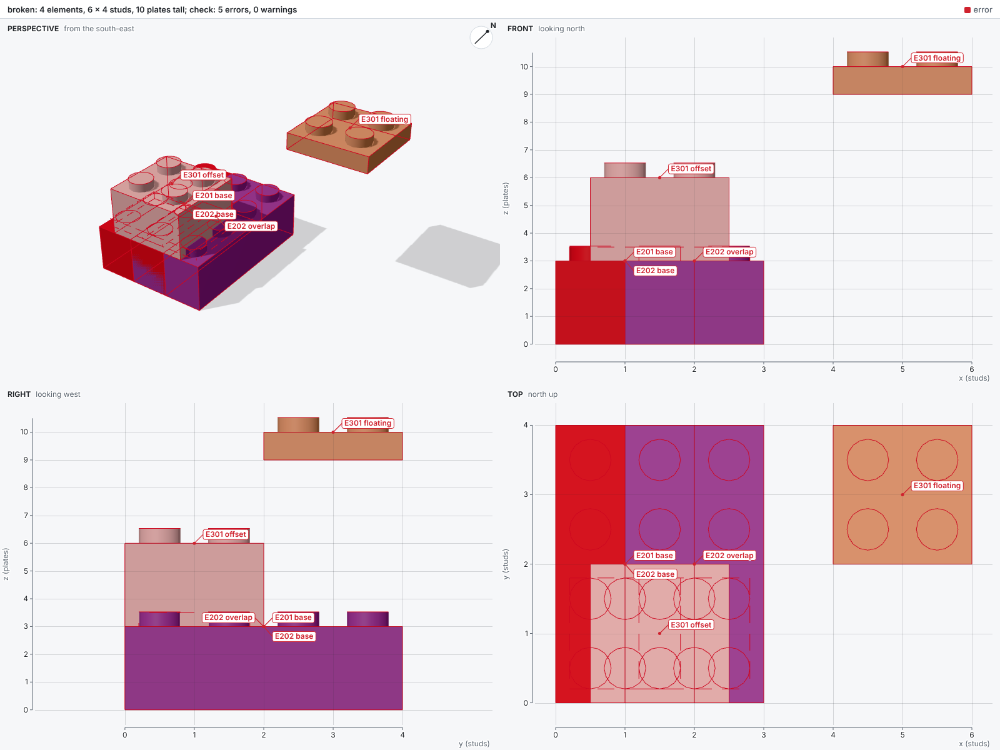

# Checks

Every build checks its model and reports facts: what is wrong, never how to fix it.

## Reading a report

A report lists diagnostics, and each diagnostic states one fact about the model: what is wrong, where, and which elements.
The report adds what each element is and the script line that placed it, so every fact leads back to the code behind it.
Deciding what to change stays with the agent: bricky never fixes a model and never suggests a fix.

The example [`examples/broken.py`](https://github.com/maxencefaldor/bricky/blob/main/examples/broken.py) makes three mistakes: an overlap, a brick half a stud off and a floating plate.

```python
builder.place("3001", at=(0, 0, 0), color="Red", id="base")  # Brick 2 x 4
builder.place("3001", at=(1, 0, 0), color="Blue", id="overlap")  # shares space
builder.place("3003", at=(0.5, 0, 3), color="White", id="offset")  # half a stud off
builder.place("3022", at=(4, 2, 9), color="Tan", id="floating")  # touches nothing
```

```text
error[overlap]: base and overlap occupy the same space
  --> x 1..2  y 0..4  z 0..3
   = base: Brick 2 x 4 (3001), Red, examples/broken.py:15 in build()
   = overlap: Brick 2 x 4 (3001), Blue, examples/broken.py:16 in build()

error[blocked-stud]: 4 studs of base push into offset, which has no anti-stud there
  --> x 0.2..1.8  y 0.2..1.8  z 3..3.5
   = base: Brick 2 x 4 (3001), Red, examples/broken.py:15 in build()
   = offset: Brick 2 x 2 (3003), White, examples/broken.py:17 in build()

error[blocked-stud]: 4 studs of overlap push into offset, which has no anti-stud there
  --> x 1.2..2.8  y 0.2..1.8  z 3..3.5
   = overlap: Brick 2 x 4 (3001), Blue, examples/broken.py:16 in build()
   = offset: Brick 2 x 2 (3003), White, examples/broken.py:17 in build()

error[floating-group]: 1 element floats: no chain of stud connections leads to the ground
  --> x 4..6  y 2..4  z 9..10
   = floating: Plate 2 x 2 (3022), Tan, examples/broken.py:18 in build()

error[floating-group]: 1 element floats: no chain of stud connections leads to the ground
  --> x 0.5..2.5  y 0..2  z 3..6
   = offset: Brick 2 x 2 (3003), White, examples/broken.py:17 in build()

by source line:
  examples/broken.py:17 in build(): 3 diagnostics
  examples/broken.py:15 in build(): 2 diagnostics
  examples/broken.py:16 in build(): 2 diagnostics
  examples/broken.py:18 in build(): 1 diagnostic

checked 4 elements against 8 rules (overloaded-studs, strained-studs ignored): 5 errors, 0 warnings
```

Each diagnostic has three parts:

1. **The fact**, after the rule it states: `error[overlap]: base and overlap occupy the same space`.
1. **The region**, after `-->`: x and y in studs, z in plates, the units of `at`.
1. **The elements**, after `=`: uid, part name and id, color, and the script line that placed the element.

The summary `by source line` ranks script lines by how many diagnostics name their elements.
The first line listed is the one to read first.
The [rules](../reference/rules.md) page gives the exact condition behind every rule, and `bricky explain blocked-stud` prints it.
The sheet tints elements an error names red and those a warning names orange.
Each diagnostic also labels its first element with its rule and marks its region with a dashed box:



## Rules and levels

Each diagnostic states the fact of one rule, and a check reports each rule at a level: `error`, `warn` or `ignore`.
An error fails the check, a warning reports a fact without failing it, and `ignore` leaves the rule out.
The rules whose facts surely make a model impossible to build, such as `overlap`, are errors by default.
The [stability](stability.md) rule `unbalanced-group` is a warning by default: it rests on measured friction and density, which real elements only approach.
The stud rules, `overloaded-studs` and `strained-studs`, are ignored by default.
The stud rules also rest on measured clutch, and their search takes minutes on large models, so a check runs them only when asked.
The command `bricky explain` prints a rule's level, the pass that checks it and its exact condition:

```text
floating-group (error, pass connectivity)
  Two elements are connected when a stud of one sits in an anti-stud of the other at the same position, facing it. [...]
```

## Configuring levels

A project sets the level of each rule in its configuration, and a command can set levels for one run, as with ty.
The table `[tool.bricky.rules]` of `pyproject.toml`, or `[rules]` in a `bricky.toml`, maps rule names to levels.
The key `all` sets every rule, and a rule's own entry overrides it.
The options `--error`, `--warn` and `--ignore` take rule names or `all`, and apply over the configuration.
The option `--warn overloaded-studs` turns one rule on for one build.
The variable `BRICKY_RULES` takes the same table as JSON (see [Configuration](../reference/configuration.md)).
A project that builds its models for real might make two stability rules errors and turn the third on:

```toml title="pyproject.toml"
[tool.bricky.rules]
unbalanced-group = "error"
overloaded-studs = "error"
strained-studs = "warn"
```

## Passes

A pass is the analysis that checks some of the rules, and any package can add passes.
Passes are pure functions of the model's shared analyses, registered under the `bricky.passes` entry-point group, each with the rules it checks.
A check runs every pass that checks a rule not ignored, so ignoring the three stability rules skips the stability solvers.
The four passes of bricky itself, `schema`, `collision`, `connectivity` and `stability`, register the same way:

```toml title="packages/bricky/pyproject.toml"
[project.entry-points."bricky.passes"]
schema = "bricky.passes.schema:SchemaPass"
collision = "bricky.passes.collision:CollisionPass"
connectivity = "bricky.passes.connectivity:ConnectivityPass"
stability = "bricky.passes.stability:StabilityPass"
```

## Changes between builds

From the second build of a script on, the report opens with what changed since the last build.
The agent can then confirm that an edit did what it meant and nothing more.
After an edit that recolors the top two courses of a tower and caps it with tiles, the report reads:

```text
since the last build: 4 added, 0 removed, 4 changed, 8 unchanged
  voxels: 16 filled, 0 emptied, 96 recolored
  added at:
    models/tower.py:19 in build(): 4 elements
  changed at:
    models/tower.py:11 in build(): 1 element
    models/tower.py:12 in build(): 1 element
    models/tower.py:15 in build(): 1 element
    models/tower.py:16 in build(): 1 element
```

Elements first match by part, color and the space they occupy, so renumbered elements count as unchanged.
The remaining elements then pair by id: the same id and part with another pose or color counts as changed.
The sheet outlines new and changed elements in purple:


