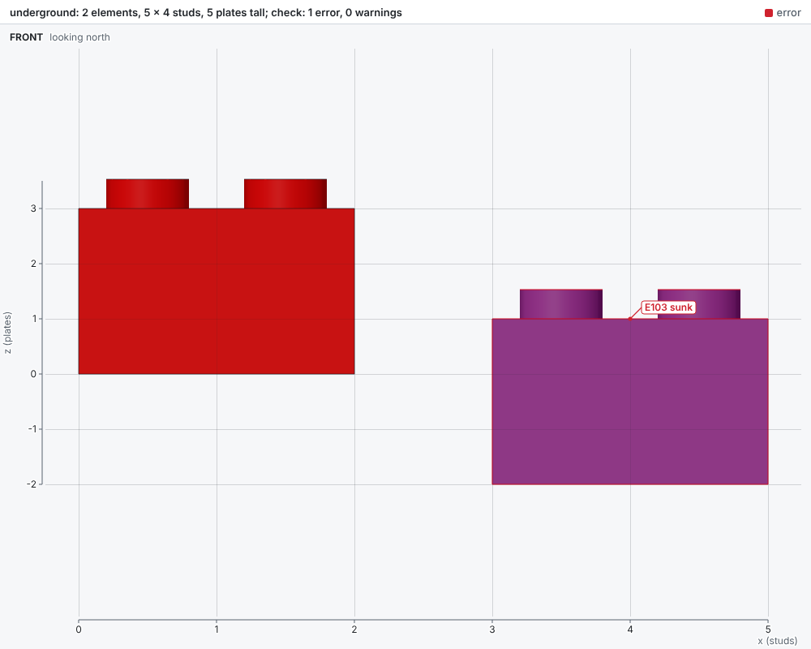
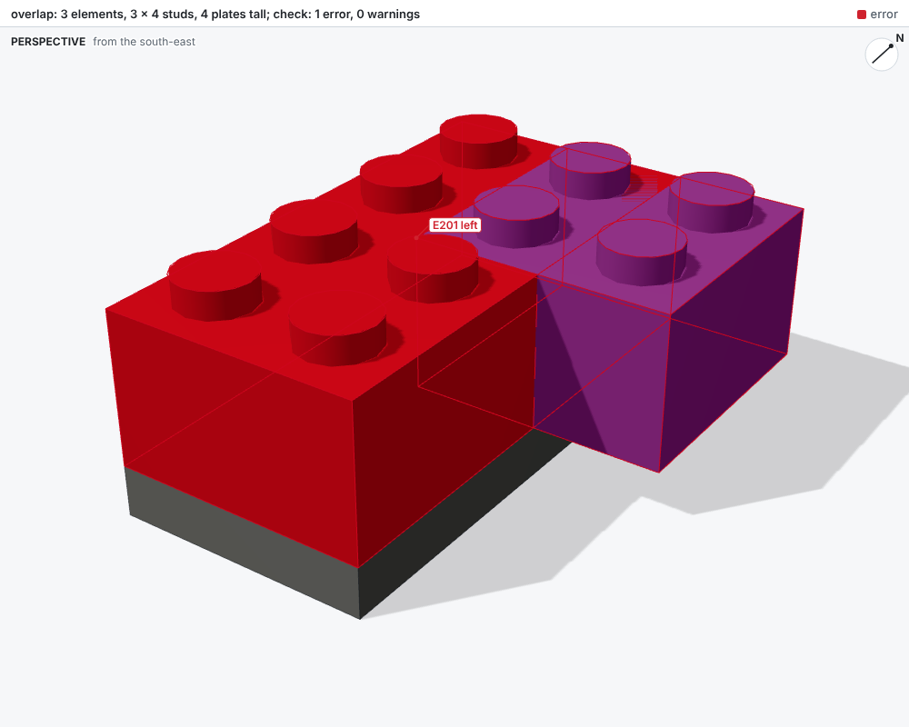
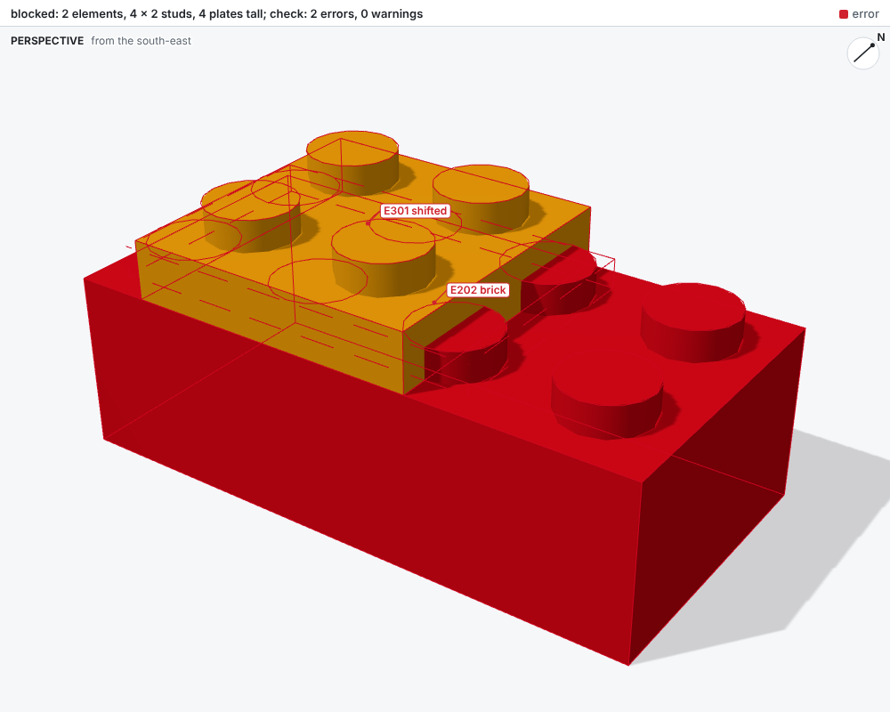
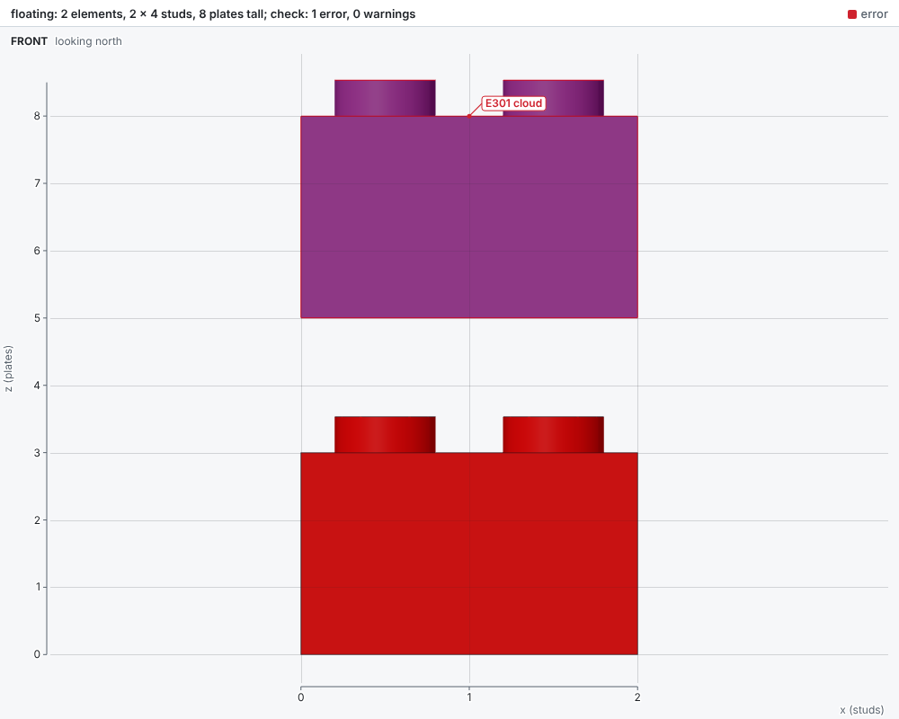

# Checks

Passes check a model and report facts as diagnostics. A diagnostic states what is wrong, where,
and which elements; the report adds what each element is and the script line that placed it.
bricky never fixes a model and never says how to: deciding what to change is the agent's job.

## Reading a report

`examples/broken.py` makes one mistake of each kind:

```python
builder.place("3001", at=(0, 0, 0), color="Red", id="base")
builder.place("3001", at=(1, 0, 0), color="Blue", id="overlap")  # shares space with base
builder.place("3003", at=(0.5, 0, 3), color="White", id="offset")  # half a stud off the grid
builder.place("3022", at=(10, 10, 6), color="Tan", id="floating")  # touches nothing
```

```text
error[E201]: base and overlap occupy the same space
  --> x 1..2  y 0..4  z 0..3
   = base: Brick 2 x 4 (3001), Red, examples/broken.py:12 in build()
   = overlap: Brick 2 x 4 (3001), Blue, examples/broken.py:13 in build()

error[E202]: 4 studs of base push into offset, which has no anti-stud there
  --> x 0.2..1.8  y 0.2..1.8  z 3..3.5
   = base: Brick 2 x 4 (3001), Red, examples/broken.py:12 in build()
   = offset: Brick 2 x 2 (3003), White, examples/broken.py:14 in build()

error[E301]: 1 element floats: no chain of stud connections leads to the ground
  --> x 10..12  y 10..12  z 6..7
   = floating: Plate 2 x 2 (3022), Tan, examples/broken.py:15 in build()

by source line:
  examples/broken.py:14 in build(): 3 diagnostics
  examples/broken.py:13 in build(): 2 diagnostics
  examples/broken.py:12 in build(): 2 diagnostics
  examples/broken.py:15 in build(): 1 diagnostic

checked 4 elements with profile digital (schema, collision, connectivity): 5 errors, 0 warnings
```

Each diagnostic has three parts:

1. **The fact**, after its code: `error[E201]: base and overlap occupy the same space`.
2. **The region**, after `-->`: x and y in studs, z in plates, the units `at` uses.
3. **The elements**, after `=`: uid, part name and id, color, and the script line that placed it.

The `by source line` summary ranks script lines by the diagnostics that name their elements, so
the first line to read is the one behind the most problems. The picture tints every named element
red, labels the first element of each diagnostic with its code, and outlines each region:


## Diagnostic codes

`bricky explain E202` prints the exact rule behind a code; `bricky explain` prints them all.

### E101 Unknown part

The element's part id is not in the catalog, or the catalog lists the part without a shape. The
element then has no geometry, and no other pass sees it.

### E102 Unknown color

The element's color id is not in the catalog.

### E103 Below the ground

The element's body reaches below the ground plane, z = 0.



### E201 Overlap

The bodies of two parts share positive volume. Faces that only touch do not count, and studs belong
to no body. The region is the box the two parts share.



### E202 Blocked stud

A stud stands inside another part's body where that part has no anti-stud facing it, so the two
parts cannot sit where they are. A plate half a stud off the grid is the classic case: the studs
below push into its underside between its anti-studs.



### E301 Floating group

Two parts are connected when a stud of one sits in an anti-stud of the other. A group of connected
parts is grounded when any part in it reaches z = 0. Each group that is not grounded is reported
once, with all its elements.



## Passes and profiles

```text
collision      E201, E202        Parts sharing space, and studs blocked by parts with no anti-stud.
connectivity   E301              Groups of parts with no connected path to the ground.
schema         E101, E102, E103  Unknown parts and colors, and parts below the ground plane.

digital (default): schema, collision, connectivity
```

`bricky passes` lists the installed passes and the profiles that run them. A pass is a pure
function of the model's shared analyses, registered under the `bricky.passes` entry-point group,
so a package can add passes without touching bricky. `--passes collision` runs one pass alone.

## Changes since the last build

From the second build of a script on, the report opens with what changed since the last build.
After an edit that recolors the top two levels of a tower and caps it with tiles:

```text
since the last build: 4 added, 0 removed, 4 changed, 8 unchanged
  voxels: 16 filled, 0 emptied, 96 recolored
  added at:
    models/tower.py:22 in build(): 4 elements
  changed at:
    models/tower.py:13 in build(): 1 element
    models/tower.py:14 in build(): 1 element
    models/tower.py:17 in build(): 1 element
    models/tower.py:18 in build(): 1 element
```

Elements match by part, color and the space they take, not by id: renumbered elements count as
unchanged. An element that kept its id and part but moved, rotated or changed color counts as
changed. The picture outlines new and changed elements in purple, so an edit that did more, or
less, than intended shows at once:


