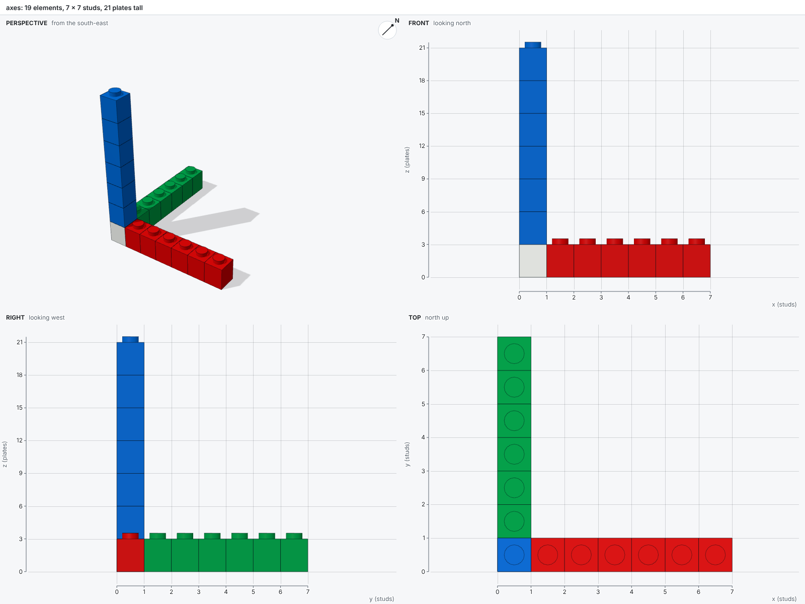
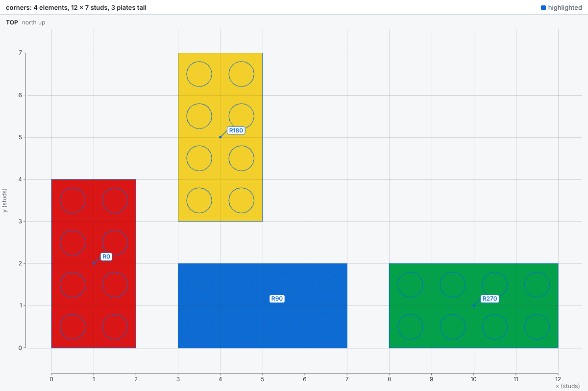
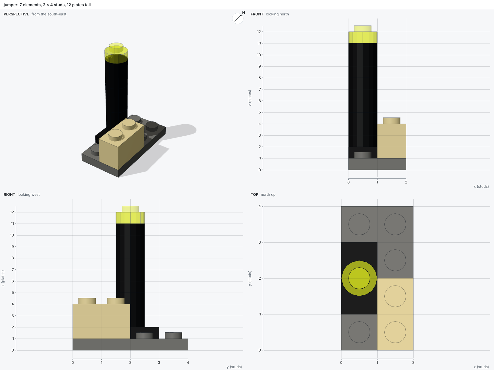

# Coordinates

Scripts place parts in studs and plates, the units every LEGO® builder counts in, and bricky converts them to exact integers.

## Axes and units

The x axis points east and the y axis north, both in studs; the z axis points up, in plates.
Studs and plates are the natural units: a brick is three plates tall, and every footprint is a whole number of studs.



| Unit | Length | Base units |
| --- | --- | --- |
| stud | 8 mm, the distance between studs | 20 |
| plate | 3.2 mm, the height of a plate | 8 |
| brick | 9.6 mm, three plates | 24 |
| base unit | 0.4 mm | 1 |

The ground is the plane z = 0.
An element below it is an error (E103), and a group of connected elements that reaches it is grounded.

## Exact integers

Every length in the kernel is a whole number of base units, so the kernel compares only integers.
The base unit, 0.4 mm, divides every LEGO System dimension exactly, so the conversion from studs and plates loses nothing.
The corner `at=(0, 1.5, 2)`, half a stud off the grid, becomes `(0, 30, 16)` in base units.
A coordinate between base units makes `place` raise `ValueError`, and the build fails.

## The `at` corner

The `at` of a part or a component is the minimum corner of its bounding box after rotation.
A rotation keeps that corner in place, so a footprint starts at `at` whatever the rotation.

```python
builder.place("3001", at=(0, 0, 0), color="Red", id="R0")
builder.place("3001", at=(3, 0, 0), rotation="R90", color="Blue", id="R90")
builder.place("3001", at=(3, 3, 0), rotation="R180", color="Yellow", id="R180")
builder.place("3001", at=(8, 0, 0), rotation="R270", color="Green", id="R270")
```



## Rotations

The four rotations `R0`, `R90`, `R180` and `R270` rotate a part about the vertical axis, counterclockwise seen from above.
A part that faces one way says so in `bricky parts`: unrotated, a slope falls toward -y, the front.


A rotation can also name where the part's own x and y axes go, which reaches all 24 grid rotations.
The identity is `+x+y`, and `+y-x` equals `R90`.
The rotations below stand a part up, to [build sideways](scripts.md#building-sideways):

| Rotation | The part's top faces |
| --- | --- |
| `+x+z` | -y, the front |
| `-x+z` | +y, the back |
| `+y+z` | +x, east |
| `-y+z` | -x, west |
| `+x-y` | down: upside down |

## Positions off the grid

A jumper plate 1 x 2 carries one stud at its center, half a stud off the grid.
A part on that stud sits off the grid too, so its `at` takes a half: the lamp post below stands at y = 1.5.

```python
builder.place("3020", at=(0, 0, 0), color="Dark Bluish Gray")  # Plate 2 x 4
builder.place("15573", at=(0, 1, 1), color="Black")  # Jumper 1 x 2
builder.place("3062", at=(0, 1.5, 2), color="Black")  # Brick, Round 1 x 1
```


