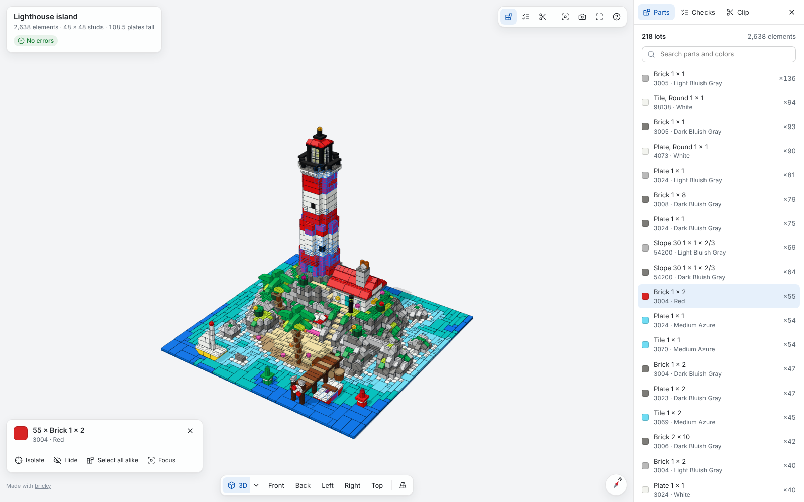

# Exports

The page shows how to export the parts a model needs, to buy them.

## Lots

A lot is one part in one color, with how many of it the model uses.
Parts and colors already carry their BrickLink ids, so a model's lots map to BrickLink items with nothing to convert.
The command `bricky export` counts a model's lots, every instance of a component included, and writes them in a format another tool reads:

```sh
uv run bricky build examples/cottage.py
uv run bricky export examples/cottage.bricky.json
```

```text
wrote examples/cottage.wanted.xml: 20 lots, 110 elements, as a BrickLink Wanted List
On BrickLink, open Want, then Upload, choose Upload BrickLink XML format, and paste the file's contents.
```


## BrickLink Wanted Lists

[BrickLink](https://www.bricklink.com), the LEGO Group's marketplace, finds the stores that sell each part of a Wanted List.
A Wanted List in BrickLink's XML holds one item per lot: the part's id, the color's id and the wanted quantity.
The file `cottage.wanted.xml` starts like this:

```xml
<INVENTORY>
  <ITEM>
    <ITEMTYPE>P</ITEMTYPE>
    <ITEMID>15573</ITEMID>
    <COLOR>11</COLOR>
    <MINQTY>1</MINQTY>
  </ITEM>
```

On BrickLink, the menu Want, then Upload, takes the list: choose Upload BrickLink XML format and paste the file's contents.
The option `--output` writes the file elsewhere, and the MCP tool `export_model` writes the same file for an agent.

## In the viewer

The 3D viewer lists the same lots in its Parts panel, most used first.
Choosing a lot selects its elements in the model, and the panel offers the Wanted List to download or copy.



## Formats left out

An export states only what bricky knows exactly, so each format must read BrickLink's ids.
LEGO's Pick a Brick reads LEGO element numbers, one per part and color.
BrickLink's catalog lists several numbers for many of these pairs, and no source says which one Pick a Brick sells.
LDraw files, which BrickLink Studio opens, number colors their own way.
No source maps BrickLink's colors to LDraw's exactly, and the names of some colors disagree between the two.
A Wanted List therefore stays the one export, until a source maps either set of numbers exactly.
