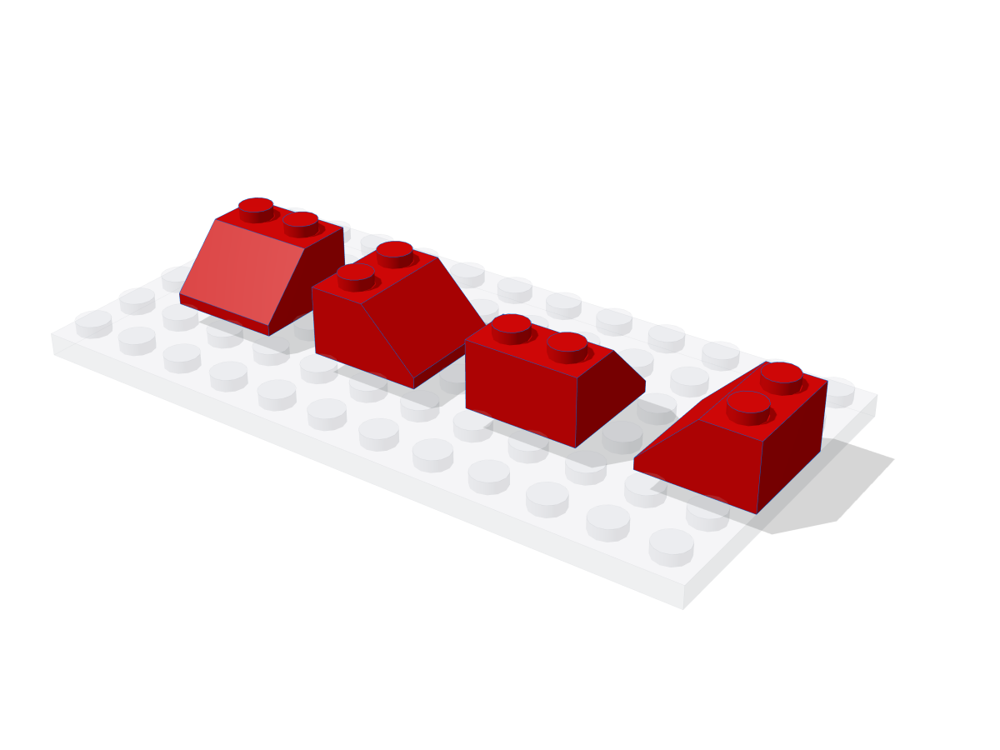
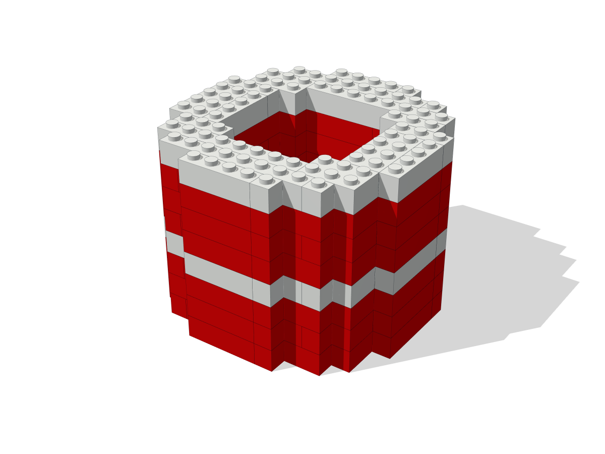
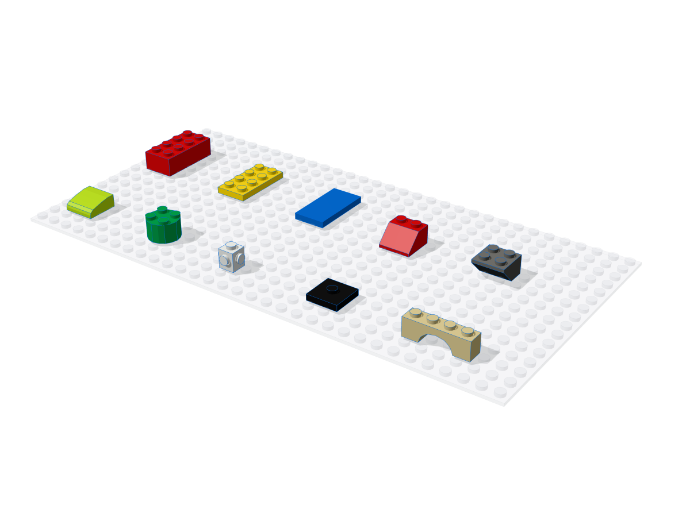
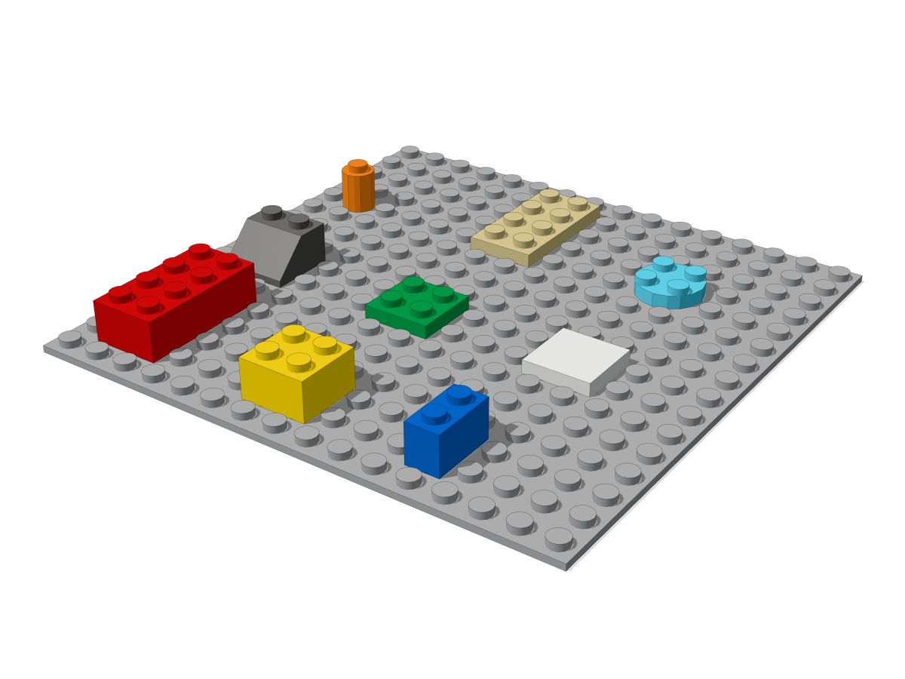
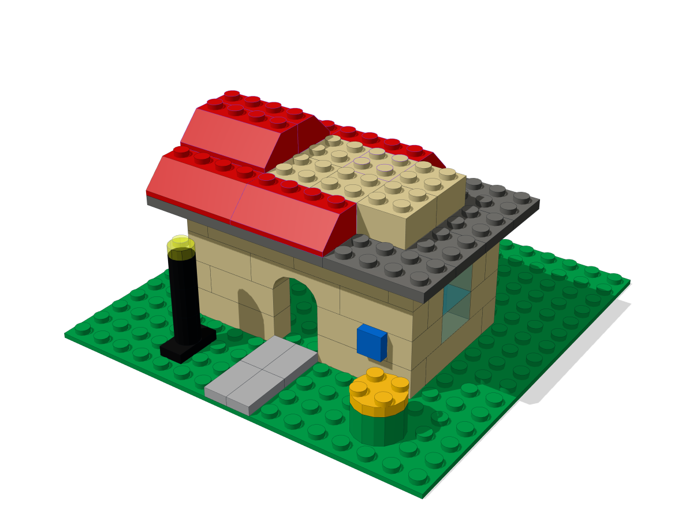
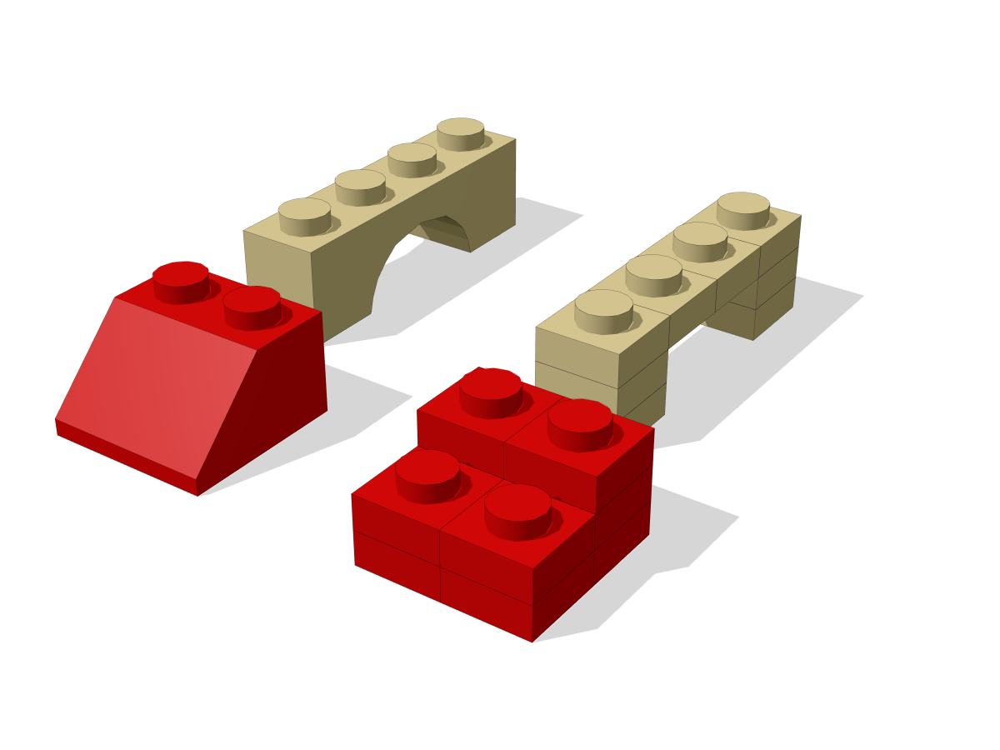
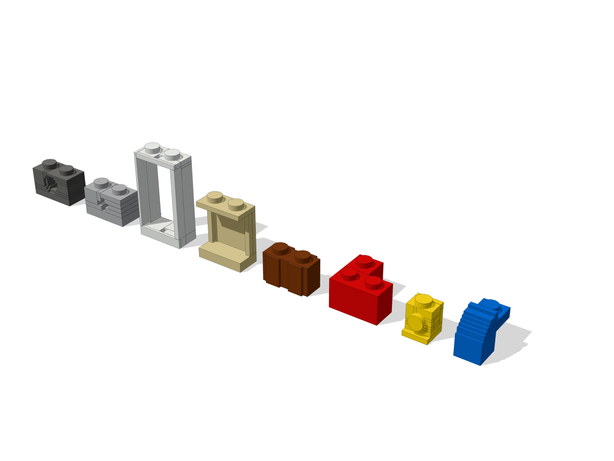

# Guide

The guide covers one concept per page, in the order a build meets them.

-   

    **[Coordinates](coordinates.md)**

    Studs, plates and exact integers: where `at` puts a part, and how rotations work.

-   

    **[Build scripts](scripts.md)**

    Python that places parts, reuses components, fills voxels and builds sideways.

-   

    **[Parts and colors](parts.md)**

    How to find a part, and the shape each family gives it.

-   

    **[Checks](checks.md)**

    How to read a report, which passes run, and what changed since the last build.

-   

    **[Images](images.md)**

    The sheet every build renders, single views, highlights, clips and the 3D viewer.

-   

    **[Exports](exports.md)**

    The parts a model needs, as a BrickLink Wanted List to buy them.

-   

    **[Instructions](instructions.md)**

    Steps to build a model, in an order that straight moves can follow.

-   

    **[Voxels](voxels.md)**

    The grid that compares a model with a plan or with another model, exactly.

-   

    **[Catalog](catalog.md)**

    Where parts and colors come from, and how to import all 97,099 parts.

