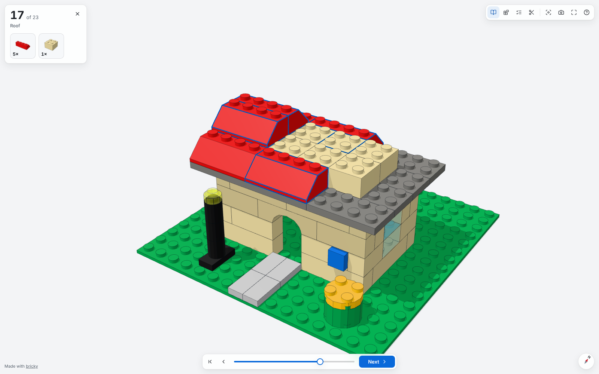

# Instructions

The page shows how to turn a model into building instructions that people follow step by step.

## Steps

The command `bricky instructions` orders a model's elements into steps, a few elements each, as LEGO® instructions do.
Large LEGO® sets add about five elements a step, so a step here adds six at most.
The steps go bottom up, and each keeps to one section of the build script: the function that `build()` called to place its elements.
A step also keeps its elements close together, within 8 studs across and about one brick in height.
The command writes a page that opens the 3D viewer on the first step:

```sh
uv run bricky build examples/cottage.py
uv run bricky instructions examples/cottage.bricky.json
```

```text
wrote examples/cottage.instructions.html: 23 steps for 110 elements, 4.8 a step on average
```


## Build order

An order is buildable when every element can go on with a straight move, and the order follows three rules.
Each element goes on along its approach: downward onto studs below it, or sideways onto side studs.
An element held from above only goes on attached under the element that holds it, and the two move as one.

1. Something holds each element as it goes on: the ground, or an element it presses onto.
1. Each connection forms as its second element goes on, so that element's approach points at the first.
1. Nothing stands in an element's way: the space its solids sweep as they arrive.

An element going on downward arrives from above the model.
An element going on sideways drops from above to a stud's height away from its place, then slides in.
The sweeps are exact, slopes included, since every solid is convex with integer corners.
The module `bricky.instructions` gives the steps to Python: here a plate goes on after the brick whose side stud holds it, moving north.

```python
from bricky import ModelBuilder, default_catalog
from bricky.instructions import build_instructions

builder = ModelBuilder("bracket")
builder.place("87087", at=(0, 1, 0), color="Red", id="brick")
builder.place("3024", at=(0, 0.6, 0.5), color="Blue", rotation="+x+z", id="plate")
steps = build_instructions(builder.build(), default_catalog()).steps
```

```pycon
>>> [(step.elements, step.approaches) for step in steps]
[((0, 1), (Vector(x=0, y=0, z=-1), Vector(x=0, y=1, z=0)))]
```

## Locked elements

Elements that lock one another in leave no order that follows every rule, and the command says which rule each step breaks.
Two overlapping bricks, for instance, stand in each other's way.
The order still places every element: it takes the one that breaks the fewest rules, lowest first, and notes what that breaks.
A model that passes the checks rarely locks, so a note usually points at a problem in the model:

```text
wrote locked.instructions.html: 1 step for 2 elements, 2.0 a step on average
1 step breaks the build order, where elements lock one another in:
  step 1: first goes on into the way of second
```

## In the viewer

The viewer's Instructions mode shows what is built so far and moves each new element in along its approach.
A card lists the parts the step adds, a picture of each with how many to take, and outlines the new elements on the model.
The camera frames each step, and turns to another corner when the new elements hide from the current one.
The arrow keys step forward and back, and the page's address names the step, such as `cottage.instructions.html#step-17`, to share it.
Every viewer that `bricky render --html` writes offers the same mode, behind the Instructions button or the key `N`.



The option `--elements-per-step` changes how many elements a step adds at most, and the MCP tool `write_instructions` writes the same page for an agent.
