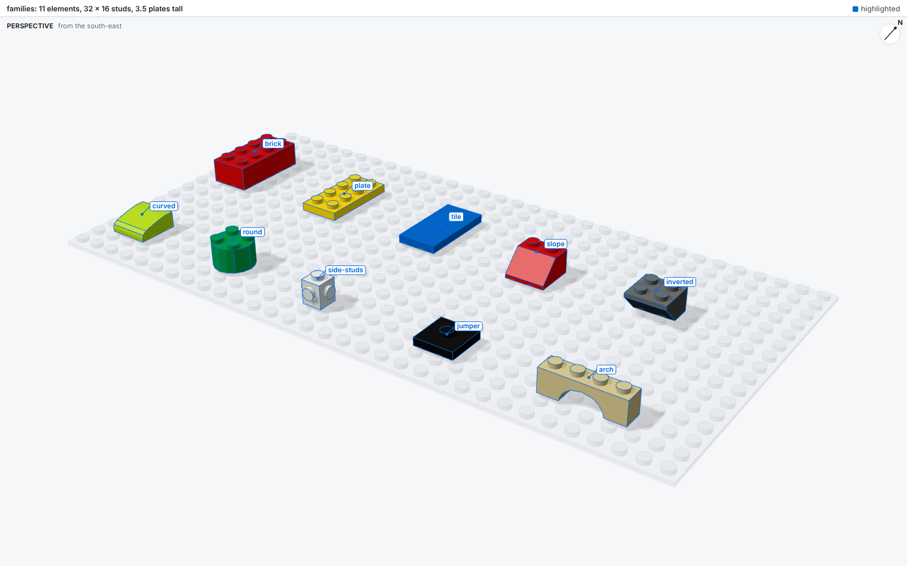
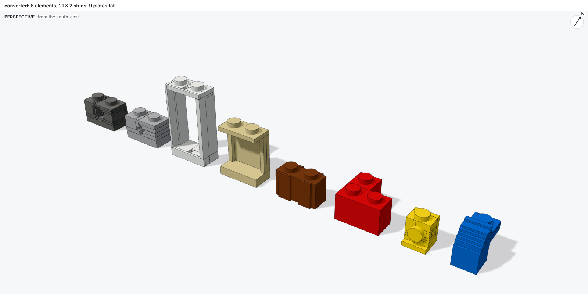
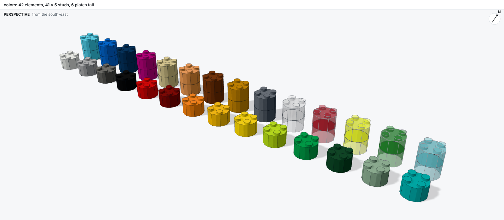

# Parts and colors

bricky knows parts and colors by their BrickLink ids, the ids LEGO® builders and sellers use:
`3001` is a Brick 2 x 4, `5` is Red. Until a catalog is [imported](catalog.md), bricky uses a
sample of 112 common parts and 40 colors.

## Finding parts

```sh
uv run bricky parts "plate 2x4"
uv run bricky parts "slope 45"
uv run bricky catalog show 3039 --render
```

`bricky parts` matches every word of the query against each part's id, name, category and family.
A size such as `2x4`, `4x2` or `2 x 4` matches whole sizes only, so `plate 1x2` finds
`Plate 1 x 2` and not `Plate 1 x 12`. Parts with a shape come first, and plainer names before
longer ones. Each row gives the family, the footprint, the height and the studs, then how the
part sits when unrotated, where that matters:

```text
id    name            family  x by y  height    studs
3040  Slope 45 2 x 1  slope   1 x 2   3 plates  1 stud
      falls toward -y (the front) when unrotated
3039  Slope 45 2 x 2  slope   2 x 2   3 plates  2 studs
      falls toward -y (the front) when unrotated
2 of 6 matching parts; --limit shows more
```

Sizes read x by y with the part unrotated: a Brick 2 x 4 (`3001`) is 2 studs along x and 4 along
y, and `R90` makes it 4 along x.

`bricky catalog show 3039` describes one part in full: its category, its other numbers, its
shape, and the colors it comes in.

From a script, `builder.catalog.find(family="plate", size=(1, 6))` returns every 1 x 6 plate,
plain parts before printed ones.

## Families

A family converts a few numbers from the catalog into a part's exact solids and connectors. One
tested generator serves every part of a family.



| Family | Parts | Shape |
| --- | --- | --- |
| brick, plate, tile | `3001`, `3020`, `87079` | Boxes; bricks and plates carry studs, tiles none |
| baseplate | `3867` | Half a plate thick: parts standing on it start at z = 0.5 |
| slope | `3039` | Falls toward -y; the rows behind the slope carry studs |
| inverted slope | `3660` | Its underside rises toward -y |
| curved slope | `15068` | Curves down toward -y, drawn as flat facets |
| round | `3941`, `4032` | Round bricks, plates and tiles, as many-sided prisms |
| side studs | `87087`, `4733` | Studs on one or more sides, facing the way the name says |
| jumper | `87580` | One stud in the middle, half a stud off the grid |
| arch | `3659` | A leg at each end, spanning along y |

Curved and round surfaces are flat facets whose corners stay on the grid: close to the real part,
and exact.

## Converted parts

Parts whose names follow no family pattern, such as windows, Technic bricks and logs, take their
shape from the [LDraw.org Parts Library](https://library.ldraw.org). The import converts each
LDraw file into boxes on a 0.8 mm grid, studs where LDraw draws them, and anti-studs wherever the
underside leaves room for a stud.



## Colors

```sh
uv run bricky colors gray
uv run bricky colors trans
```

`bricky colors "#F2CD37"` lists the five colors nearest to an RGB value, to match a color seen
in a picture. Colors carry BrickLink's names and ids, such as `Dark Bluish Gray` (`85`), an RGB
value, and a type: solid, transparent, pearl, metallic and more. Renders draw transparent parts see-through and
pearl parts with a sheen.



A script names a color by name or by id: `color="Red"` and `color=5` are the same.
