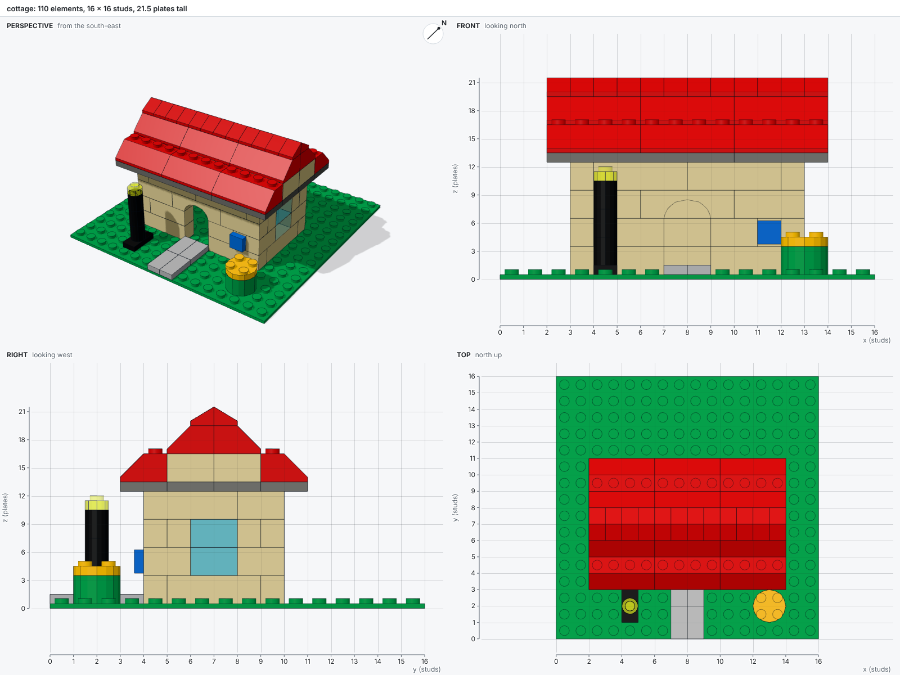
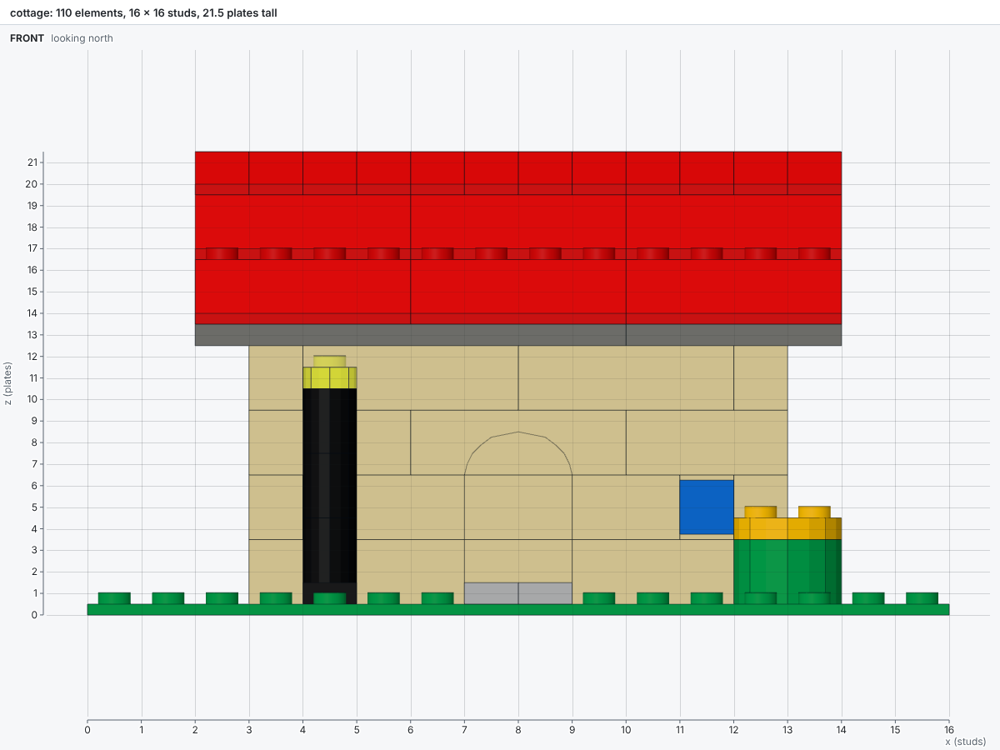
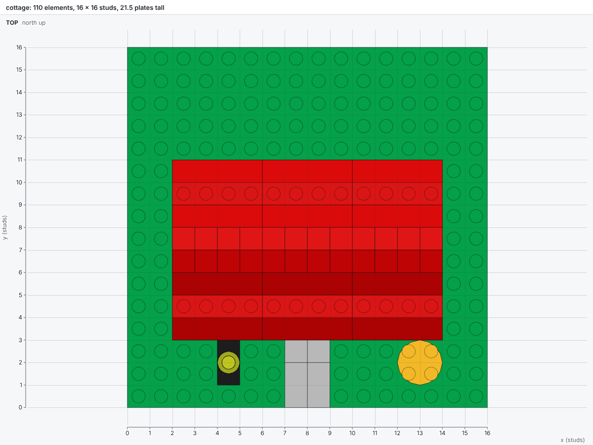
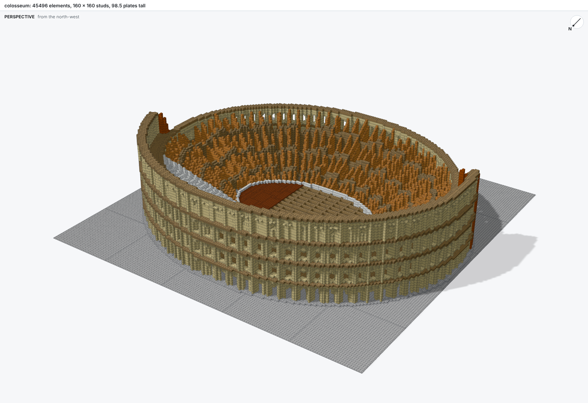
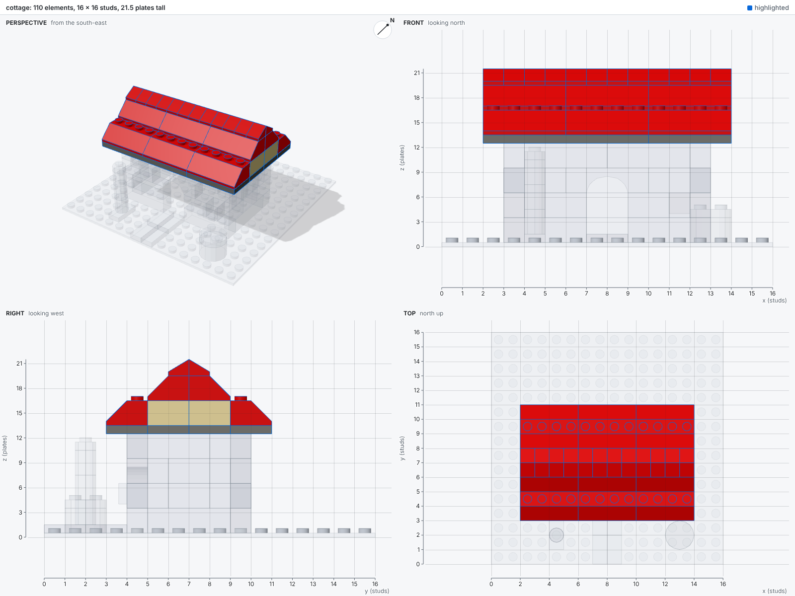
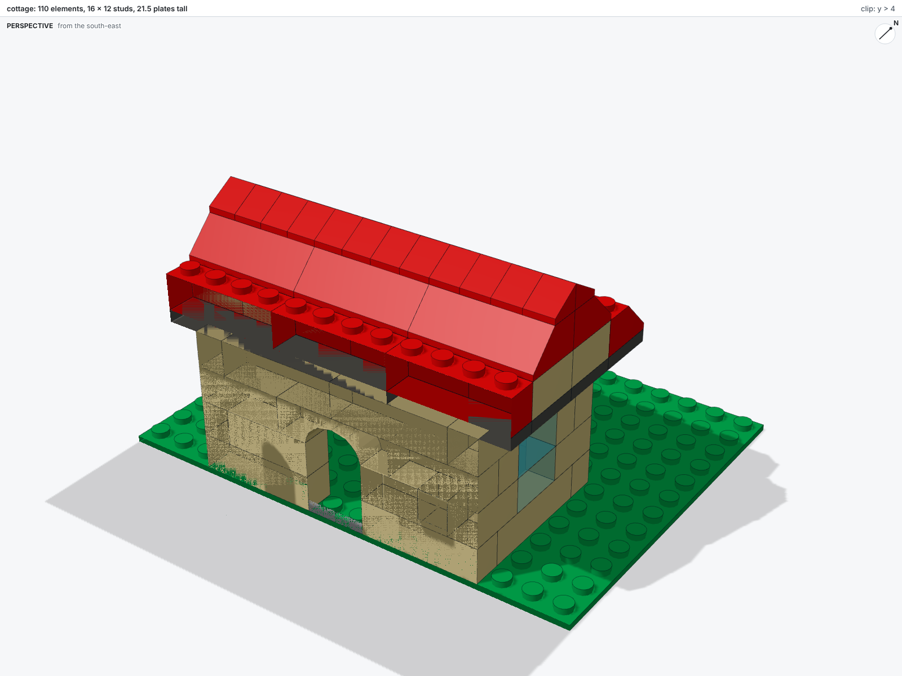
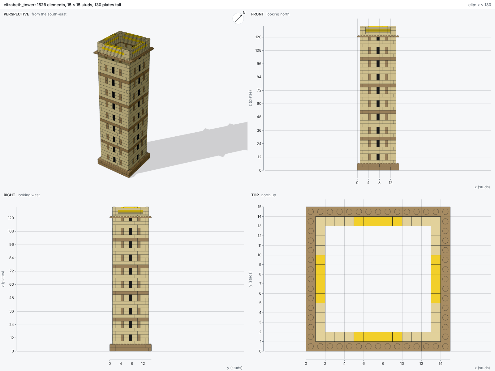

# Pictures

Every build draws its model. The checks say whether a model is valid; the pictures show whether
it looks like what was meant. bricky draws with three.js in headless Chromium, vendored, so
renders work offline.

## The sheet

A build writes `name.png` beside the script: a sheet of four views. The perspective view looks
from the south-east, with a compass. The front, right and top views are orthographic, with rulers
in studs and plates, so a position read off a picture is a position to write in the script.



The title line counts the elements and gives the model's size; after a check, it adds the errors
and warnings.

## Single views

`bricky render` draws a saved model again, with options, and writes `name.<view>.png` beside it,
so the picture the last build drew stays as it was.

```sh
uv run bricky render models/cottage.bricky.json --views front --views top
```

| View | Looks |
| --- | --- |
| `sheet` | Perspective, front, right and top on one image (the default) |
| `perspective` | From the south-east, above |
| `perspective-south-west`, `perspective-north-west`, `perspective-north-east` | From the other corners, above |
| `front`, `back` | Looking north, and looking south, with x and z rulers |
| `left`, `right` | Looking east, and looking west, with y and z rulers |
| `top` | North up, with x and y rulers |





The perspectives from the other corners show the sides the sheet hides. The Colosseum keeps its
outer ring on the north side, so its façade shows from the north-west:

```sh
uv run bricky render examples/colosseum.bricky.json --views perspective-north-west
```



## Highlights

`--highlight` draws some elements in full and the rest faintly, and labels the highlighted
elements with their uids. A selector is a uid pattern, or `@` and a function, file or line of the
build script:

| Selector | Highlights |
| --- | --- |
| `--highlight "lintel*"` | Elements whose uids match the pattern |
| `--highlight "tower/*"` | Every element inside the instance `tower` |
| `--highlight @horseshoe` | Every element the function `horseshoe` placed |
| `--highlight @stonehenge.py:142` | Every element line 142 placed |

Script selectors read the source map the build wrote. Stonehenge with `--highlight @horseshoe`:



## Clips

`--clip` keeps what lies on one side of a plane, to look inside a model: `z<130` keeps what lies
below 130 plates, and `x>4` what lies east of 4 studs. Clips combine, and the views frame what is
left.

```sh
uv run bricky render models/cottage.bricky.json --views perspective --clip "y>4"
```





## The viewer

`--html` also writes `name.html`, a standalone viewer people can orbit, zoom and clip by height in
a browser. The page embeds the scene and loads three.js from a CDN.

## Marks

| Mark | Means |
| --- | --- |
| Red tint and label | An element an error names |
| Orange tint and label | An element a warning names |
| Dashed box | The region of a diagnostic |
| Purple outline | An element new or changed since the last build |
| Blue outline and label | A highlighted element |
| Faint gray | An element outside the highlight |
