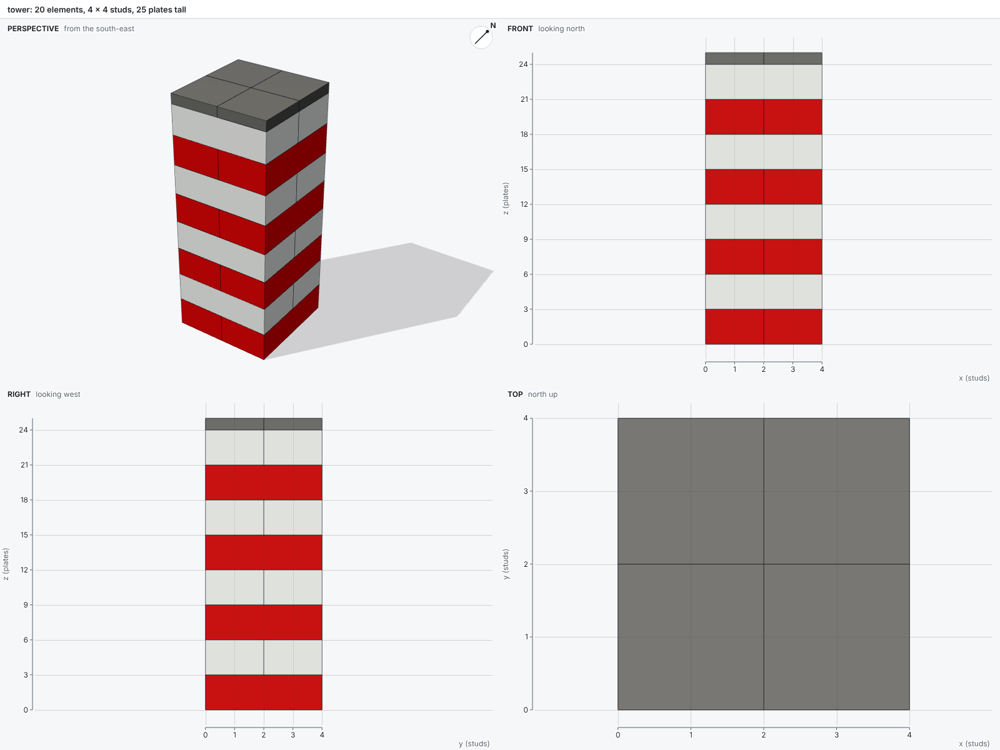
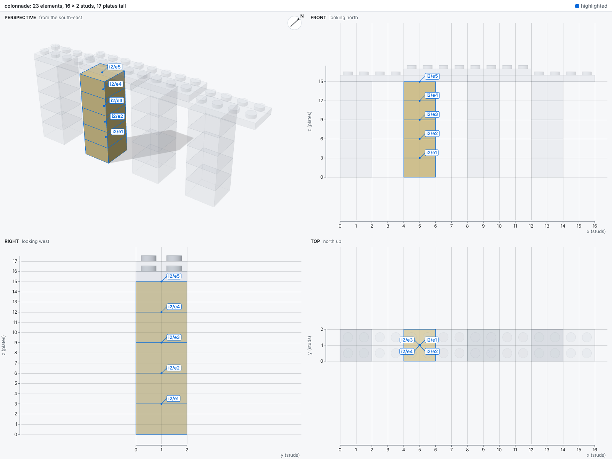
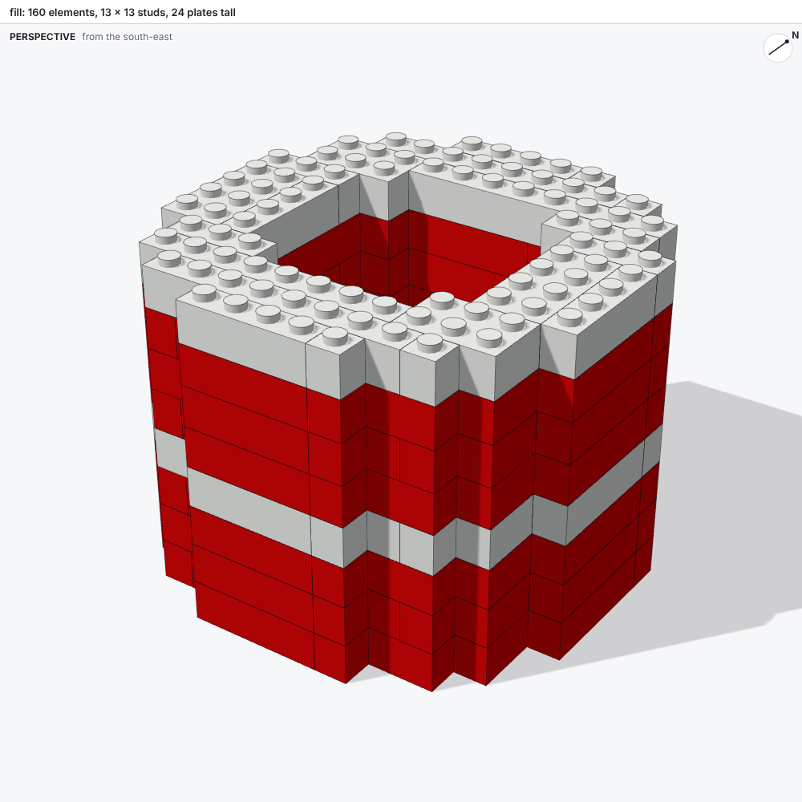
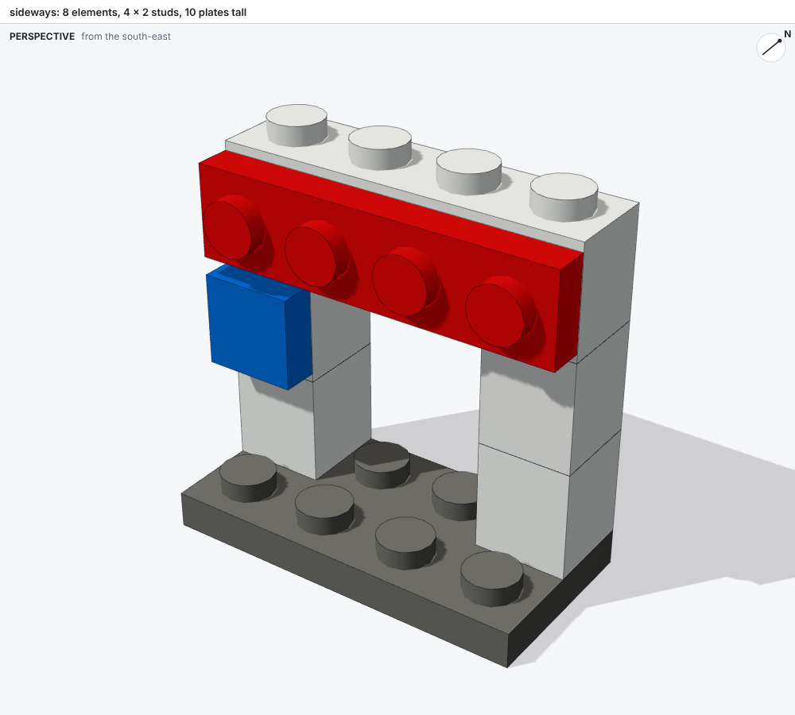

# Build scripts

A build script describes a model as ordinary Python, so loops, functions and data can generate it.

## The script

A build script is a Python file that defines `build()` and returns a `ModelBuilder`.
Python supplies what a model needs to repeat itself: loops for courses, functions for features that recur, and data for anything measured.
The build runs the script in its own process with a time limit, so a script that hangs or crashes never stops bricky.
Anything the script prints appears in the report.

```python
from bricky import ModelBuilder


def build() -> ModelBuilder:
    builder = ModelBuilder("tower")
    for course in range(8):
        z = 3 * course
        if course % 2 == 0:
            builder.place("3001", at=(0, 0, z), color="Red")
            builder.place("3001", at=(2, 0, z), color="Red")
        else:  # each course rotates 90 degrees, so every brick bridges the two below
            builder.place("3001", at=(0, 0, z), rotation="R90", color="White")
            builder.place("3001", at=(0, 2, z), rotation="R90", color="White")
    return builder
```



## Placing parts

A call to `builder.place(part, at=(x, y, z), color=..., rotation="R0", id=None)` places one part and returns its id:

| Argument | Meaning |
| --- | --- |
| `part` | A BrickLink part id, such as `"3001"`, or any other number of the same part |
| `at` | The minimum corner of the rotated part, in studs and plates (see [Coordinates](coordinates.md)) |
| `color` | A color name or id |
| `rotation` | `R0`, `R90`, `R180`, `R270`, or any of the 24 grid rotations |
| `id` | The element's name; an unnamed element gets `e` and its position among everything placed in its model or component, such as `e2` |

Elements that matter deserve an id: the report and the images label elements by id, and `--highlight` selects them by id.

## Components and instances

A component stores a group of elements once, and each instance places a copy of it.
One definition keeps every copy identical: a change to the component changes every instance.

```python
column = builder.component("column")
for course in range(5):
    column.place("3003", at=(0, 0, 3 * course), color="Tan")

for index in range(4):
    builder.instance("column", at=(index * 4, 0, 0))
```

The `at` of an instance is the minimum corner of the rotated component, exactly as for a part.
Components may hold instances of other components.
An element inside an instance has a uid that joins the ids of the instances that hold it: `i2/e3` names the element `e3` inside the instance `i2`.
The colonnade below highlights `i2/*`, its second column:



## Filling voxels

Curves, domes and anything copied from a plan are easiest to describe as voxels: the color that fills each stud square, one plate tall.
A call to `builder.fill(voxels)` covers such a plan with bricks and plates, each part as large as fits.
Bricks go where the three layers of a course share a color, and plates go everywhere else.
Courses alternate direction so that joints stagger, and every part rests on the layer below.
Overhangs take plates that reach back to the parts that hold them, so floors span between walls and cornices stand out from them.

```python
from math import hypot

INNER, OUTER = 4, 6.5  # the wall's radii, in studs
STRIPE = 3  # the fourth of every four courses is white

tower = {
    (x, y, z): "White" if z // 3 % 4 == STRIPE else "Red"
    for x in range(-6, 7)
    for y in range(-6, 7)
    for z in range(24)
    if INNER <= hypot(x, y) < OUTER
}
builder.fill(tower, id="tower")  # ids such as tower.4.-2.9: the prefix, then the corner
```



The function `plan_fill` in `bricky.fill` returns the same parts as data, to inspect or adjust before placing them.
[The Colosseum](../gallery.md) fills 242,576 voxels this way.

## Building sideways

Bricks with studs on their sides hold parts rotated to face them.
A tile or plate rotated `+x+z` faces -y, so its underside grips a side stud that faces -y:

```python
builder.place("87087", at=(0, 1, 4), color="White")  # Brick 1 x 1, stud on its side
builder.place("3070", at=(0, 0.6, 4.5), rotation="+x+z", color="Blue")  # Tile 1 x 1
```

The upright tile is 0.4 studs deep, a plate's height, and one stud tall, 2.5 plates.
Its minimum corner therefore sits 0.4 studs in front of the brick and half a plate above its base.
The tile then ends flush with the top of the brick.



## What a build writes

A build of `models/name.py` writes three files beside the script:

| File | Holds |
| --- | --- |
| `name.bricky.json` | The model: part ids, colors and poses, nothing else |
| `name.bricky.map.json` | The source map: the script lines that placed each element |
| `name.png` | The sheet: four views with rulers |

The source map records the SHA-256 hash of its model file, so bricky ignores a map left over from an older model.
The commands `bricky check` and `bricky render` read both files.
