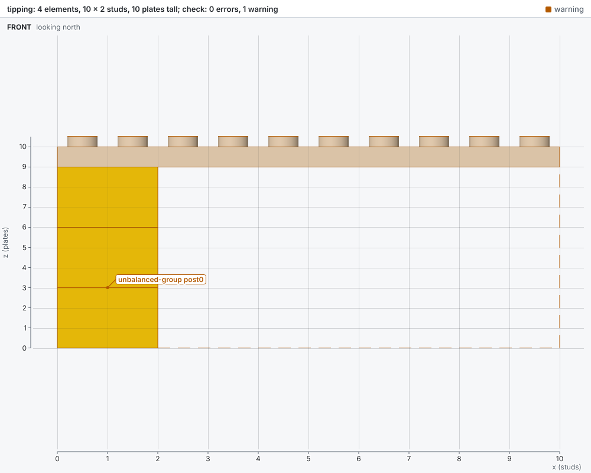
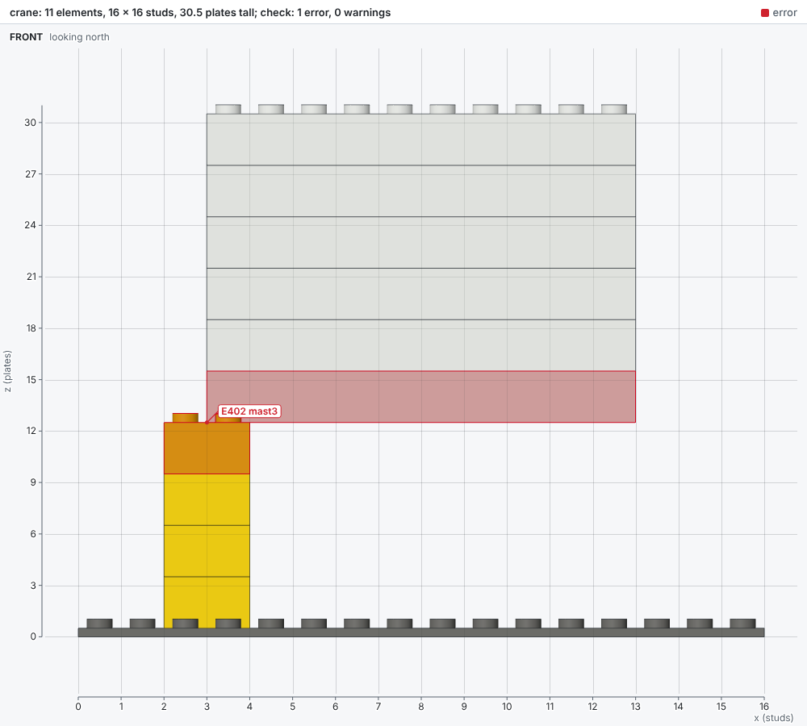

# Stability

The page shows how bricky checks that a model stands under its own weight and that its studs hold it together.

## The stability rules

Every check tests whether the model stands under its own weight, as a real build on a table.
Three rules report what fails: `unbalanced-group`, `overloaded-studs` and `strained-studs`.
The rule `unbalanced-group` is a warning by default: it rests on measured friction and density, which real elements only approach.
The two stud rules are ignored by default, since they rest on measured clutch too and their search takes minutes on large models.
The options `--warn overloaded-studs --warn strained-studs` turn them on for one build.
A project that builds its models for real can make all three errors (see [Checks](checks.md#configuring-levels)).
Here a crane's jib stands on a single stud of its mast, built with `--warn overloaded-studs`:

```text
warning[overloaded-studs]: 1 stud joining 2 elements needs 107% of its clutch to hold the model together
  --> x 3.2..3.8  y 7.2..7.8  z 12.5..13
   = mast3: Brick 2 x 2 (3003), Yellow, models/crane.py:8 in build()
   = jib0: Brick 2 x 10 (3006), White, models/crane.py:10 in build()

by source line:
  models/crane.py:8 in build(): 1 diagnostic
  models/crane.py:10 in build(): 1 diagnostic

checked 11 elements against 9 rules (strained-studs ignored): 0 errors, 1 warning
```

## Forces

Each element is a rigid body that weighs its volume times a density, and forces act only where elements touch.

- Faces that face up and down press on each other, since weight closes any gap between them.
- Faces that face sideways press only where each is the top or bottom of its part or holds its studs or anti-studs.
  The sides of LEGO® parts stand 0.1 mm in from the grid, so the sides of neighbors never touch.
- Faces that no stud joins also rub, with friction.
- A stud bears any sideways force and resists pulling out of its anti-stud with its clutch.
- A stud alone where two elements meet face to face also resists twisting, at its 2.4 mm radius, and its pull and twist share its clutch.
  Two or more studs there resist any twist together.
- The ground presses up wherever an element reaches it, with friction.

A model stands when some set of these forces balances every element: the forces and torques on each sum to zero.
Finding such forces is a linear program, the lower bound of limit analysis that studies of masonry and of LEGO® structures use ([Whiting et al., 2009](https://doi.org/10.1145/1618452.1618458); [Liu et al., 2024](https://arxiv.org/abs/2402.10711)).
The interior point solver [Clarabel](https://clarabel.org) settles most models in a few seconds.
When some stud grips hard, [HiGHS](https://highs.dev) moves those forces to a vertex by crossover, and its simplex method finds the exact loads.
That search takes seconds to a minute for thousands of elements, and a check skips it unless a rule of studs is on.
The module `bricky.analysis.stability` gives the same analysis to Python: here a 1 x 8 plate reaches 6 studs past the brick it stands on.

```python
from bricky import ModelBuilder, Settings, default_catalog
from bricky.analysis import Context
from bricky.analysis.stability import Material, analyze_stability

builder = ModelBuilder("arm")
builder.place("3031", at=(0, 0, 0), color="Green", id="base")
builder.place("3003", at=(0, 0, 1), color="Yellow", id="post")
builder.place("3460", at=(0, 0, 4), color="Red", rotation="R90", id="arm")
context = Context(builder.build(), default_catalog())
stability = analyze_stability(context, Material.of(Settings()), threshold=0.001)
uids = [element.uid for element in context.world.elements]
```

```pycon
>>> [([uids[i] for i in site.elements], f"{site.load:.2%}") for site in stability.sites]
[(['post', 'arm'], '0.30%')]
```

## Groups that fall

A group falls when no forces balance it, however firmly its studs grip: it tips over an edge, slides, or drops off what it rests on.
Studs that grip without limit hold elements together rigidly, so the check moves whole groups of joined elements.
The rule `unbalanced-group` names each group that moves, such as a post and the arm on it that reaches past its foot:



## Studs that pull out

A stud holds its anti-stud with a force called its clutch, and the check finds how much of that clutch each stud must use.
Many sets of forces hold a model still, so the check takes the one where the most loaded stud uses the least share of its clutch.
The studs that set that share form a site, one for each group of elements that would move together to pull them out.
The search then repeats with those studs holding without limit.
Each site therefore needs its share of clutch however much the sites before it hold.
The rule `overloaded-studs` names a site that needs more than its whole clutch.
The rule `strained-studs` names one that needs more than half of it, with the default safety factor of 2.
A heavy jib on a single stud of a crane's mast needs 107% of that stud's clutch:



## Settings

Four settings describe the material, and their defaults come from measurements of real elements.

| Setting | Default | Meaning |
| --- | --- | --- |
| `clutch` | 2.94 N | Force that pulls one stud out: three contact points of 0.98 N each, as [StableLego](https://arxiv.org/abs/2402.10711) measured |
| `friction` | 0.2 | Coefficient of friction between faces, a cautious value for ABS |
| `density` | 0.54 g/cm³ | Mass of an element's body per volume, hollows included, fitted to the bricks StableLego weighed |
| `safety_factor` | 2 | Times a stud's clutch must exceed its load before `strained-studs` leaves it out |

A project that builds with worn elements might lower the clutch, in its `pyproject.toml`:

```toml
[tool.bricky]
clutch = 2.0
```

## Limits

The analysis answers whether forces exist that hold the model, and leaves out what changes those forces.

- Elements are rigid, so a long beam of plates holds as if it never bent.
- Loads are the model's own weight, at rest: no hand that lifts it, and no shaking.
- Weights come from volumes, within about a quarter of what real elements weigh.
- Clutch varies with wear, color and temperature, which the safety factor covers.

The lower bound of limit analysis also lets studs share loads in the best way they can, so a site's share is the least it needs.
A site near its limit in the report is therefore a site to strengthen first.
