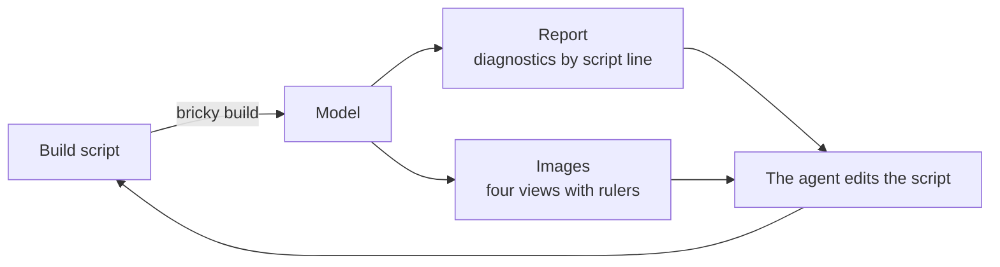

<div class="bricky-hero" markdown>

<div class="bricky-hero-text" markdown>

# bricky

A compiler-style toolkit that lets AI agents design buildable LEGO® models.
{ .bricky-tagline }

An agent writes a model as a Python build script.
In return, bricky places every part in exact geometry, checks that the model holds together, and renders it.

[Get started](get-started.md){ .md-button .md-button--primary } [Gallery in 3D](gallery.md){ .md-button }

</div>

{ .bricky-hero-image }

</div>

## The loop

An agent builds like a programmer with a compiler and a camera: it writes, builds, reads and fixes.
The loop ends when the report says `0 errors` and the images show the intended model.



## The docs

The docs come in five parts: start with the tutorial, then read the guide or jump to the part you need.

<div class="grid cards bricky-links bricky-lead" markdown>

-   🚀 **[Get started](get-started.md)**

    A tutorial: build a wall, break it and fix it, in five minutes.

-   📘 **[Guide](guide/index.md)**

    One page per concept: coordinates, build scripts, parts, checks, images, voxels and the catalog.

-   🤖 **[Agents](agents/index.md)**

    Connect an agent through the command line, MCP or the skill, and measure it with the benchmark.

-   🖼️ **[Gallery](gallery.md)**

    Every example in 3D, from a tower to the Colosseum.

-   📚 **[Reference](reference/index.md)**

    Every command, diagnostic code, setting and Python function.

</div>

## Install

Installing bricky takes [uv](https://docs.astral.sh/uv/), which installs Python 3.15 and every dependency:

```sh
git clone https://github.com/maxencefaldor/bricky && cd bricky
uv sync
uv run playwright install chromium       # the browser bricky renders in, once per machine
uv run bricky build examples/cottage.py  # build, check and render the cottage
```
