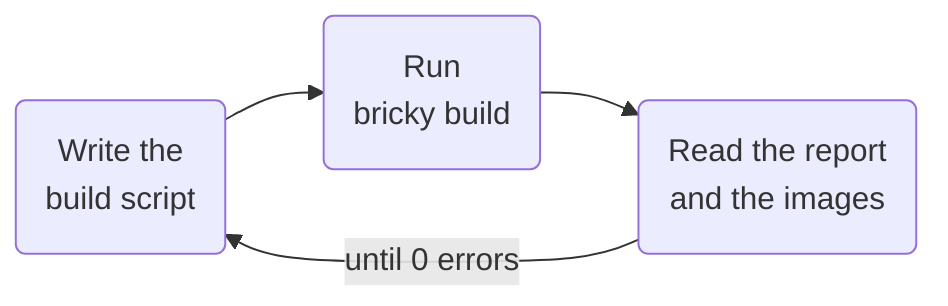

<div class="bricky-hero" markdown>

# bricky

A compiler for LEGO® models, built for AI agents.
{ .bricky-tagline }

An agent writes a model as a Python build script.
Each build places every part in exact geometry, reports each error with the script line behind it, and renders the model in four views.

[Get started](get-started.md){ .md-button .md-button--primary } [Gallery in 3D](gallery.md){ .md-button }

{ .bricky-hero-image }

</div>

<div class="grid cards bricky-links" markdown>

-   📘 **[Guide](guide/index.md)**

    One page per concept: coordinates, build scripts, parts, checks, stability, images, voxels and the catalog.

-   🤖 **[Agents](agents/index.md)**

    Connect an agent through the command line, the MCP server or the skill, and measure it with the benchmark.

-   🖼️ **[Gallery](gallery.md)**

    The gallery's models in 3D viewers, from a Japanese garden and a pirate ship to the Colosseum.

-   📚 **[Reference](reference/index.md)**

    Every command, rule, setting and Python function.

</div>

## How it works

Each build saves the model the script describes, checks it and renders it.
The agent reads the report and the images, edits the script and builds again.
The loop ends when the report says `0 errors` and the images show the intended model.



## Install

A [uv](https://docs.astral.sh/uv/) project holds your build scripts, and uv installs Python if needed.
The project pins Python 3.14, the version bricky recommends: on 3.15, installing compiles the solver HiGHS, which needs a C++ compiler.

```sh
uv init --bare --pin-python --python 3.14 my-models  # a project for your build scripts
cd my-models
uv add bricky                                        # bricky and every dependency, from PyPI
uv run playwright install chromium                   # the browser bricky renders in, once per machine
```

The [Get started](get-started.md#install) page also covers pip, a tool install and a clone of the repository.
To try an example, download it into the project and build it:

```sh
curl -O https://raw.githubusercontent.com/maxencefaldor/bricky/main/examples/japanese_garden.py
uv run bricky build japanese_garden.py
```
