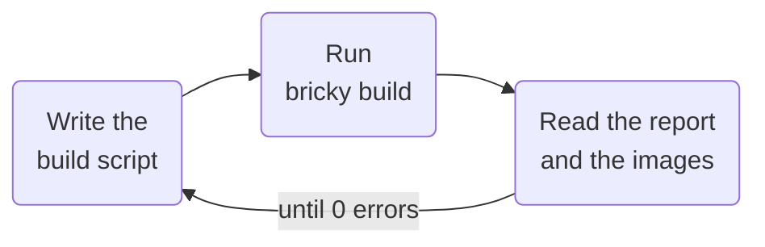

<div class="bricky-hero" markdown>

# bricky

A compiler-style toolkit that lets AI agents design buildable LEGO® models.
{ .bricky-tagline }

An agent writes a model as a Python build script.
Each build places every part in exact geometry, reports each error with the script line behind it, and renders the model in four views.

[Get started](get-started.md){ .md-button .md-button--primary } [Gallery in 3D](gallery.md){ .md-button }

{ .bricky-hero-image }

</div>

<div class="grid cards bricky-links" markdown>

-   📘 **[Guide](guide/index.md)**

    One page per concept: coordinates, build scripts, parts, checks, images, voxels and the catalog.

-   🤖 **[Agents](agents/index.md)**

    Connect an agent through the command line, MCP or the skill, and measure it with the benchmark.

-   🖼️ **[Gallery](gallery.md)**

    Every example in a 3D viewer, from a tower of 20 elements to the Colosseum.

-   📚 **[Reference](reference/index.md)**

    Every command, diagnostic code, setting and Python function.

</div>

## How it works

Each build saves the model the script describes, checks it and renders it.
The agent reads the report and the images, edits the script and builds again, until the report says `0 errors` and the images show the intended model.



## Install

Installing bricky takes [uv](https://docs.astral.sh/uv/), which installs Python 3.15 and every dependency:

```sh
git clone https://github.com/maxencefaldor/bricky && cd bricky
uv sync
uv run playwright install chromium       # the browser bricky renders in
uv run bricky build examples/cottage.py  # build, check and render the cottage
```
