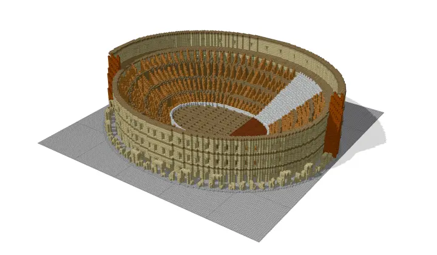
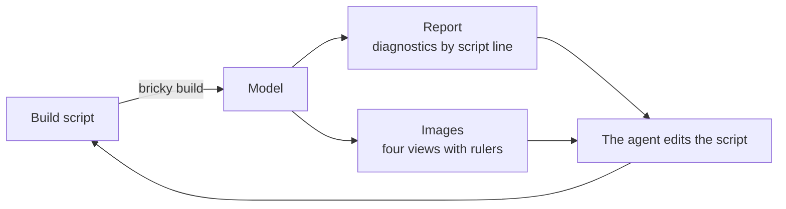
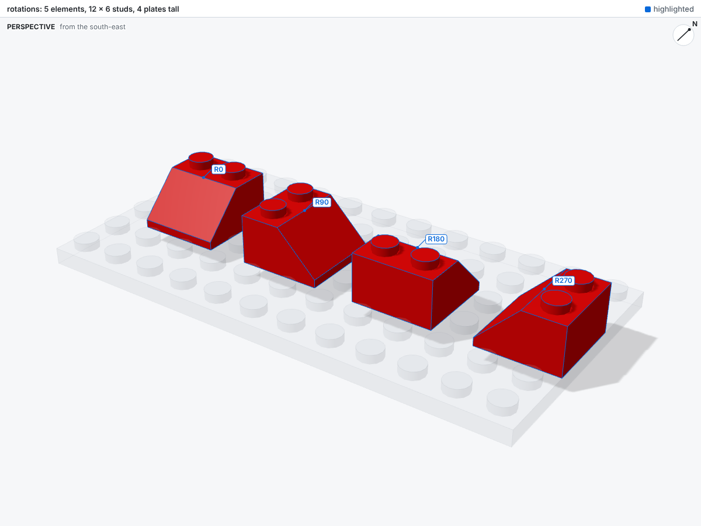
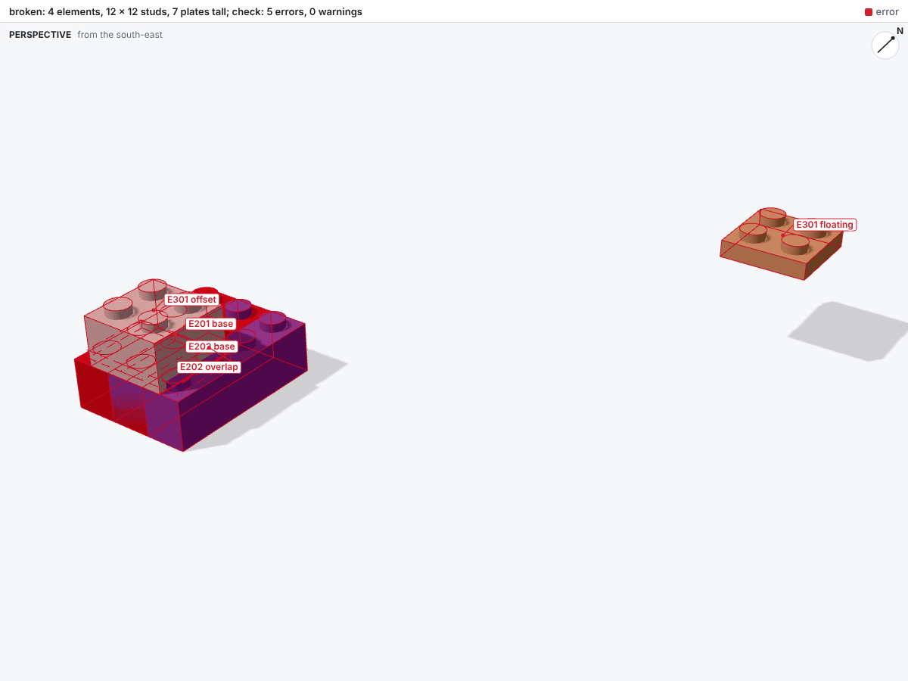
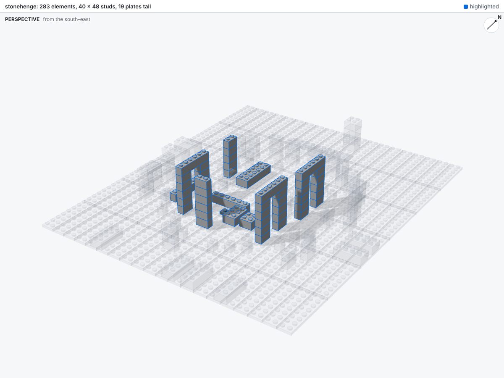
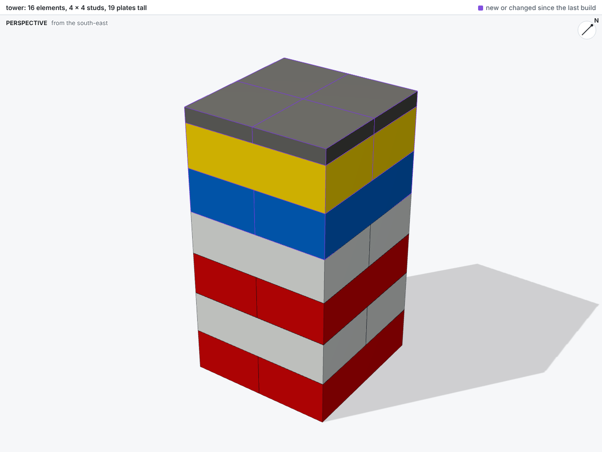
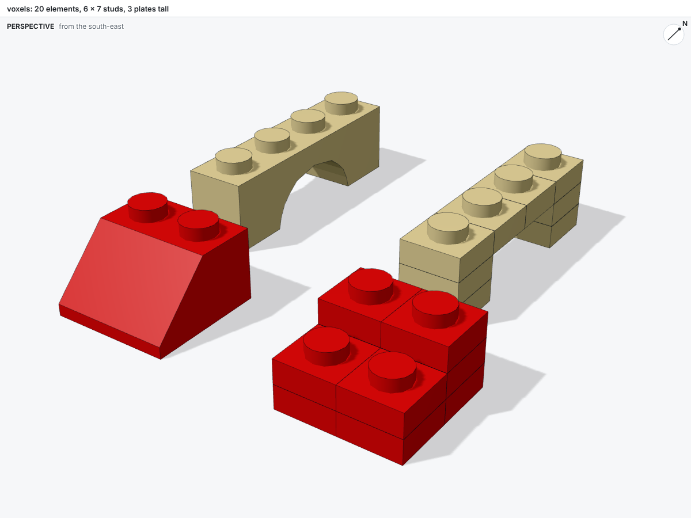

<div class="bricky-hero" markdown>

<div class="bricky-hero-text" markdown>

# bricky

A compiler-style toolkit that lets AI agents design buildable LEGO® models.
{ .bricky-tagline }

An agent writes a model as a Python build script.
In return, bricky places every part in exact geometry, checks that the model holds together, and renders it.

[Get started](get-started.md){ .md-button .md-button--primary } [Gallery in 3D](gallery.md){ .md-button }

</div>

{ .bricky-hero-image }

</div>

## The loop

An agent builds like a programmer with a compiler and a camera: it writes, builds, reads, and fixes until the report says `0 errors` and the images show the intended model.



## What an agent gets

<div class="grid cards bricky-cards" markdown>

-   

    **[Exact geometry](guide/coordinates.md)**

    Every length is a whole number of 0.4 mm units, so every overlap test is exact.

-   

    **[Real parts](guide/parts.md)**

    Every BrickLink part and color, with exact shapes for the common families.

-   

    **[Checks that state facts](guide/checks.md)**

    Each diagnostic says what is wrong, where, and which script line placed the elements.

-   

    **[Images that measure](guide/images.md)**

    Every build renders four views with rulers in studs and plates.

-   

    **[Changes between builds](guide/checks.md#changes-between-builds)**

    Each build counts what changed since the last one, by script line.

-   

    **[Voxels](guide/voxels.md)**

    Models fill voxels one stud square and one plate tall, so comparisons are exact.

</div>

## Install

Installing bricky takes [uv](https://docs.astral.sh/uv/), which installs Python 3.15 and every dependency:

```sh
git clone https://github.com/maxencefaldor/bricky && cd bricky
uv sync
uv run playwright install chromium       # the browser bricky renders in, once per machine
uv run bricky build examples/cottage.py  # build, check and render the cottage
```

## Where next

<div class="grid cards bricky-links" markdown>

-   **[Get started](get-started.md)**

    Build a wall, break it and fix it, in five minutes.

-   **[Connect an agent](agents/connect.md)**

    Reach bricky from Claude Code or any harness, through the command line or MCP.

-   **[Gallery](gallery.md)**

    Orbit every example in 3D, from a tower to the Colosseum.

-   **[Benchmark](agents/benchmark.md)**

    Ten projects that measure how well an agent builds.

</div>
