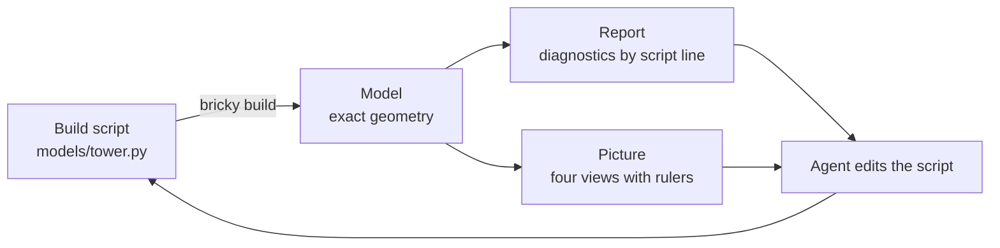

# bricky

bricky lets AI agents design buildable LEGO® models.
An agent writes a model as a Python build script.
bricky runs the script, places every part in exact geometry, checks that the model holds together, and draws it.
Every answer states facts the agent can act on: each diagnostic names the script line behind its parts, and every picture carries rulers in studs and plates.


## The loop

An agent works like a programmer with a compiler and a camera.



The loop ends when the report says `0 errors` and the pictures show the intended model.

## What bricky gives an agent

<div class="grid cards" markdown>

-   **Exact geometry**

    ---

    Every length is a whole number of 0.4 mm units.
    Positions, the 24 grid rotations and every overlap test are exact.

    

    [Coordinates](guide/coordinates.md)

-   **Real parts**

    ---

    Parts and colors carry their BrickLink ids.
    Bricks, plates, tiles, slopes, round parts, arches, jumpers and bricks with side studs get exact shapes; LDraw shapes every other part.

    

    [Parts and colors](guide/parts.md)

-   **Checks that state facts**

    ---

    Overlapping parts, blocked studs, floating groups: each diagnostic says what is wrong, where, which elements, and the script line that placed them.

    

    [Checks](guide/checks.md)

-   **Pictures that measure**

    ---

    Every build draws a perspective view and three orthographic views with rulers.
    Highlights pick out elements by id or by script function; clips open the model up.

    

    [Pictures](guide/pictures.md)

-   **Changes between builds**

    ---

    Each build reports what changed since the last one, by script line, and outlines new and changed elements in purple.

    

    [Changes](guide/checks.md#changes-since-the-last-build)

-   **Voxels**

    ---

    `voxels(model)` maps every stud-square, plate-tall voxel a model fills, to compare a model with a plan or a reference exactly.

    

    [Voxels](guide/voxels.md)

</div>

## Install

bricky needs [uv](https://docs.astral.sh/uv/), which installs Python 3.15 and every tool from the lock file.

```sh
git clone https://github.com/maxencefaldor/bricky
cd bricky
uv sync
uv run playwright install chromium  # the browser renders draw in, once per machine
uv run bricky build examples/cottage.py
```

[Get started](get-started.md) walks through a first model.
Agents connect through the [command line](reference/cli.md), the [MCP server](agents/mcp.md) or the [skill](agents/skill.md).

## Status

bricky is pre-alpha.
The model format, the catalog and the checks work end to end; the benchmark in [`benchmark/`](agents/benchmark.md) measures how well agents build with them.

LEGO® is a trademark of the LEGO Group, which does not sponsor, authorize or endorse this project.
Part shapes converted from the [LDraw.org Parts Library](https://library.ldraw.org) are licensed under CC BY 4.0.
